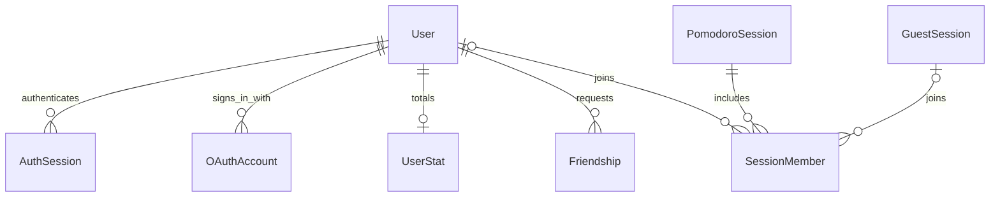

# WePomodoro backend

Express 5 + Prisma 7 + PostgreSQL. This single document covers setup, the HTTP
API, the data model, timer accounting, and testing. A product “server” is a
`PomodoroSession` in the database: a named space with members and one shared
timer. Chat, minigames and online status are not stored in the database: they
run over WebSocket, built separately.

Contents:

1. [Setup and running](#1-setup-and-running)
2. [Authentication](#2-authentication)
3. [API reference](#3-api-reference)
4. [Data model](#4-data-model)
5. [How timers and statistics work](#5-how-timers-and-statistics-work)
6. [Chat, minigames and WebSocket](#6-chat-minigames-and-websocket)
7. [Deletion and lifecycle](#7-deletion-and-lifecycle)
8. [Migrations](#8-migrations)
9. [Testing](#9-testing)
10. [Source map and frontend integration](#10-source-map-and-frontend-integration)

---

## 1. Setup and running

The API uses `backend/.env` (`DATABASE_URL`). Copy `.env.example` and fill it in.

```bash
cd backend
npm ci
npm run db:deploy   # applies committed migrations to DATABASE_URL
npm run dev         # generates the Prisma client, then starts tsx watch
```

`db:deploy` changes tables in the configured database; starting the API never
applies migrations. For a compiled run use `npm run build` then `npm start`.

To browse the database, run `make studio`
(opens on http://localhost:5555/).
Production transport should provide HTTPS so bearer tokens aren't sent in clear.

Environment variables:

| Variable                                                                         | Default                 | Meaning                                                              |
| -------------------------------------------------------------------------------- | ----------------------- | -------------------------------------------------------------------- |
| `DATABASE_URL`                                                                   | none (required)         | PostgreSQL connection string                                         |
| `PORT`                                                                           | `3000`                  | Listening port (1–65535)                                             |
| `CORS_ORIGIN`                                                                    | `http://localhost:5173` | Comma-separated exact origins allowed to call the API                |
| `OAUTH_REDIRECT_BASE`                                                            | `http://localhost:3000` | Public URL of this API; the provider callback URLs are built from it |
| `FRONTEND_URL`                                                                   | `http://localhost:5173` | Where the browser is sent after a provider sign-in (one origin)      |
| `GOOGLE_CLIENT_ID`, `GOOGLE_CLIENT_SECRET` (same for `GITHUB_` and `FORTY_TWO_`) | empty                   | Both set enables that provider; empty disables it                    |

In development (`NODE_ENV` not `production`) the API also serves a test console at
`http://localhost:3000/dev`: presets for the main endpoints, with the token, session
ID and session code filled in from earlier responses. It is not mounted
in production. The OAuth redirect flow itself can't run there: sign in with a
provider in a browser, paste the `code` from the redirect URL
(`/auth/oauth?code=…`) into the `oauthCode` variable, and send "Swap the
one-time code for a session" to get a token.

To skip tokens in the console, set `DEV_AUTH=true` in `backend/.env` and restart. A
"no token, act as" checkbox then appears in the console header with a list of
users and guests; requests carry `X-Dev-User: <username>` (or `guest:<id>`) instead
of a Bearer token, and untick it to use a real token again. The header is ignored
unless `DEV_AUTH=true` and `NODE_ENV` is not `production`; never enable it on a
shared server, since it lets any caller act as anyone.

Requests with no `Origin` header (curl, native clients) are accepted. A browser
`Origin` that isn't listed gets 403. CORS is not authentication.

With Docker Compose the backend runs as the unprivileged `node` user (uid 1000),
so files generated into the bind-mounted source tree (such as
`src/generated/prisma`) belong to your user, not root.

Shutdown (`SIGINT`/`SIGTERM`) stops the timer worker, closes idle keep-alive
connections, waits for an in-flight sweep, disconnects Prisma, and exits. If that
takes longer than 10 seconds the process exits with code 1.

---

## 2. Authentication

All endpoints live under `/api`; there are no root-path aliases. The only
non-`/api` route is `GET /`, which returns `{ service, health }`.

Signup/login return a random `token`, its expiry, and a safe user profile. Guests
receive a token and a temporary guest profile. Send the token on later requests:

```http
Authorization: Bearer <token>
```

- Registered sessions last **7 days**, guest sessions **24 hours**.
- Only SHA-256 hashes of tokens are stored. Passwords use salted scrypt with
  constant-time comparison.
- Rate limits (per process, in memory): signup, login, guest creation and
  `POST /api/users` allow 20 requests per IP per minute, and login additionally
  allows 8 **failed** attempts per username per 15 minutes (successful logins
  don't count, and `Alice`/`alice` share one counter). Exceeding either returns
  429 with `Retry-After`. A multi-instance deployment should also enforce a
  shared limit at its gateway.
- Behind a reverse proxy set `TRUST_PROXY` to the number of proxies (0 when
  exposed directly). Too low makes all clients share the proxy's IP; too high
  lets clients spoof their IP with `X-Forwarded-For`.
- Existing profiles with a null `passwordHash` cannot password-login. Don't
  recreate accounts or let someone claim a passwordless profile by supplying its
  email; they need an explicit provisioning/recovery flow (email delivery and
  verification are not implemented). New signups require a password.
- Accounts created through OAuth also have a null `passwordHash`: they can't
  password-login, and `PATCH /users/me` and the two-factor toggle (which ask for
  the current password) don't work for them until they add a password with the
  forgot-password flow.
- Registered logout revokes the current token and leaves timers running. Guest
  logout removes the temporary identity and its memberships (a guest keeps no
  stats); sessions it owned pass to another member, and a session left empty is
  deleted.
- A worker finalizes elapsed timers about once per second and removes expired
  auth/guest identities every minute.

Input rules:

- Usernames: 3–32 letters, numbers, underscores or hyphens; lowercased. A real
  42 login is refused at password signup and username change when 42 is configured.
- Emails: valid format, at most 254 characters; trimmed and lowercased.
- Passwords: 8–128 characters; never trimmed. `currentPassword` and the password
  sent to `DELETE /api/users/me` are only checked for being a string of at most
  128 characters, so accounts with older, shorter passwords can still verify.
- Guest names: 1–32 characters after trimming. A name equal to a registered
  username (case-insensitive) or a real 42 login (see "Reserved 42 logins") is
  refused with 409, so a guest can't pose as that user.

---

## 3. API reference

**Base URL:** `http://localhost:3000/api`. Send JSON with
`Content-Type: application/json` (bodies are limited to 16 KB). Success responses
are JSON, except 204 which has no body. UUID placeholders need real IDs; user IDs
are integers.

Access labels: **Public** = no token; **Authenticated** = registered user or
guest; **Registered** = registered user; **Member** = session member;
**Owner** = the member flagged `isOwner`; **Owner/mod** = owner, or a moderator/admin who is a member (see 3.8).

### 3.1 Service and authentication

| Method | Endpoint                             | Access        | JSON body                             | Response                                                                                                                |
| ------ | ------------------------------------ | ------------- | ------------------------------------- | ----------------------------------------------------------------------------------------------------------------------- |
| GET    | `/api/health`                        | Public        | None                                  | 200 `{ status: "ok" }`; 503 if the database is unreachable or a committed migration isn't applied                       |
| POST   | `/api/auth/signup`                   | Public        | `{ "email", "username", "password" }` | 201 `{ token, expiresAt, user }`                                                                                        |
| POST   | `/api/users`                         | Public        | Same signup body                      | 201: alias of signup with the same response                                                                             |
| POST   | `/api/auth/login`                    | Public        | `{ "username", "password" }`          | 200 `{ token, expiresAt, user }`; with two-factor on: `{ twoFactorRequired, challengeToken, expiresAt }` and no session |
| POST   | `/api/auth/login/2fa`                | Public        | `{ "challengeToken", "code" }`        | 200 `{ token, expiresAt, user }`; 401 on a wrong code                                                                   |
| POST   | `/api/auth/login/2fa/resend`         | Public        | `{ "challengeToken" }`                | 204: emails a new code (3 per 15 minutes per sign-in); 401 if the attempt expired                                       |
| POST   | `/api/auth/guest`                    | Public        | `{ "displayName" }`                   | 201 `{ token, guest: { id, displayName, expiresAt } }`                                                                  |
| GET    | `/api/auth/oauth`                    | Public        | None                                  | 200 `{ providers: ["google", ...] }`: the enabled providers                                                             |
| GET    | `/api/auth/oauth/:provider`          | Public        | None                                  | 302 to the provider and sets the `oauth_state` cookie; 404 for an unknown or disabled provider                          |
| GET    | `/api/auth/oauth/:provider/callback` | Public        | None                                  | 302 to `FRONTEND_URL/auth/oauth?code=…` or `?error=…`; never JSON                                                       |
| POST   | `/api/auth/oauth/exchange`           | Public        | `{ "code" }`                          | 200 `{ token, expiresAt, user }`; 401 for a used, unknown or expired code                                               |
| POST   | `/api/auth/password-reset/request`   | Public        | `{ "email" }`                         | 202 same message whether or not the account exists; emails a 6-digit code                                               |
| POST   | `/api/auth/password-reset/verify`    | Public        | `{ "email", "code" }`                 | 200 `{ resetToken, expiresAt }`; the code is spent                                                                      |
| POST   | `/api/auth/password-reset/confirm`   | Public        | `{ "resetToken", "password" }`        | 204; sets the password and signs out every session                                                                      |
| POST   | `/api/auth/verify-email`             | Registered    | `{ "code" }`                          | 204: confirms the address; sets `emailVerifiedAt`                                                                       |
| POST   | `/api/auth/verify-email/resend`      | Registered    | None                                  | 202: emails a new code (3 per 15 minutes); 409 if already verified                                                      |
| POST   | `/api/auth/verify-email/cancel`      | Registered    | None                                  | 204: deletes a pending signup; 409 if verified                                                                          |
| GET    | `/api/auth/me`                       | Authenticated | None                                  | 200 `{ type: "user" or "guest", profile }`                                                                              |
| POST   | `/api/auth/logout`                   | Authenticated | None                                  | 204: revoke login or delete temporary guest identity                                                                    |

### Two-factor authentication (email code)

Optional per account: once on, signing in also needs a six-digit code emailed to
the account's address (no authenticator app, no recovery codes). Intended UX:
after signup the client offers to turn it on (the user can skip), and a
registered user can turn it on or off later from their profile page. Turning it
on or off takes the account password **and** a code emailed to the account, in
two steps:

| Method | Endpoint                        | Body                     | Result                                             |
| ------ | ------------------------------- | ------------------------ | -------------------------------------------------- |
| GET    | `/api/auth/2fa`                 | None                     | `{ enabled }`                                      |
| POST   | `/api/auth/2fa/enable/request`  | `{ "password" }`         | 204: emails a code; 401 wrong password; 409 if on  |
| POST   | `/api/auth/2fa/enable`          | `{ "password", "code" }` | 204: now active                                    |
| POST   | `/api/auth/2fa/disable/request` | `{ "password" }`         | 204: emails a code; 401 wrong password; 409 if off |
| POST   | `/api/auth/2fa/disable`         | `{ "password", "code" }` | 204: off; pending sign-ins are cancelled           |

The confirming calls answer 400 for a wrong, expired, missing or locked code
(same message in every case) and 401 for a wrong password. A code lives 5
minutes, only the newest request for each action is valid, only its hash is
stored, and after 5 wrong guesses it is dead and a new one must be requested.
Codes are tied to their purpose: a sign-in code can't turn two-factor on or off,
nor the other way round. Guests get 403. Failed attempts on these four calls are
limited to 8 per 15 minutes per account.

Once on, `POST /api/auth/login` answers a correct password with
`{ twoFactorRequired: true, challengeToken, expiresAt }` instead of a session and
emails a code. The client then calls `POST /api/auth/login/2fa` with that token and
the `code` within 5 minutes. A wrong code answers 401 and five wrong codes cancel
the challenge (sign in again); a used challenge is gone, so a code works once.
`POST /api/auth/login/2fa/resend` emails a new code for a live challenge (the old
code stops working): the expiry and the count of wrong guesses are kept, so a
resend gives no extra guesses, and resends are limited to 3 per 15 minutes per
sign-in. Password reset ends all sessions but leaves two-factor on, and an
administrator can switch it off for a user who lost access to their email. The
codes are sent through the `Mailer` (see below), so in production every
two-factor sign-in depends on email delivery.

The health check compares the `prisma/migrations` folders with the database's
`_prisma_migrations` table, so a forgotten `db:deploy` shows up as 503. If the
folder isn't shipped with the build the comparison is skipped.
Authentication runs before protected routing, so unknown paths without a valid
token may return 401 before 404.

### Sign in with OAuth (Google, GitHub, 42)

Optional per provider: one whose client id and secret are empty is disabled.
Signup and login are the same flow, because the backend decides between them.

1. The frontend sends the browser (a full page navigation, not `fetch`) to
   `GET /api/auth/oauth/:provider`. The API sets an `oauth_state` cookie (random,
   `HttpOnly`, `SameSite=Lax`, scoped to `/api/auth/oauth`, 10 minutes, `Secure`
   in production) and redirects to the provider.
2. The provider redirects to `GET /api/auth/oauth/:provider/callback?code&state`.
   The API compares `state` with the cookie, swaps the code for a token, reads
   the profile (`fetch`, 5 second timeout), finds or creates the user and issues
   a **one-time code** (60 seconds, stored hashed in `OAuthCode`). The callback
   is a page navigation, so it always redirects to the frontend:
   `FRONTEND_URL/auth/oauth?code=…` on success or `?error=…` on failure
   (`state`, `denied`, `no_email`, `email_taken`, `failed`).
3. The frontend sends the code to `POST /api/auth/oauth/exchange` and receives
   `{ token, expiresAt, user }`, like a successful password login. A code works
   once. The session token never appears in a URL.

Which user the sign-in resolves to:

- A linked identity, matched by `(provider, providerUserId)` only (never by email
  after the first link), signs in as its user.
- Otherwise, if the provider **vouches for the email** (Google `email_verified`,
  GitHub's primary verified email): an existing account with that email that is
  verified gets the provider linked; an existing **unverified account** is never
  taken over (the redirect carries `error=email_taken`). With no
  existing account a new one is created, already verified.
- If the provider **doesn't vouch** for the email (42, or GitHub without a
  verified email): the email is never linked to an existing account
  (`error=email_taken`). A new account is created **unverified**, like a password
  signup: the six-digit code is emailed, and the token is
  limited to the verification routes until the code is entered.
- A new username comes from the provider's login (lowercased, other characters
  replaced by `_`); on a clash a random four-character suffix is added.

Reserved 42 logins: when 42 is configured, a username that is a real 42 login
(checked with `GET /v2/users/<login>` using the app's own token) is refused with
`409 That name belongs to a 42 account; sign in with 42 instead` at password
signup, username change and guest creation. Google and GitHub sign-ins whose
login is a real 42 login get a random suffix. A 42 sign-in is never blocked.
Answers are cached 10 minutes (5000 names, per process). If 42 can't be reached
the check is skipped (fail open) and the error is logged. Admin-created users
aren't checked.

OAuth login does not ask for the email two-factor code: the provider is the
second factor. A user with a password and two-factor who also linked a provider
can therefore sign in with the provider without the code. OAuth-only accounts
have no password (see section 2).

The `/api/auth/oauth` routes are limited to 20 requests per IP per minute, for
every method (the signup and login limiter only counts `POST`). Provider
failures (timeout, non-2xx, malformed answer) become `error=failed` and are
logged.

### Email verification

Signup creates the account, returns the session token as before, and emails a
six-digit code (valid 10 minutes, newest only, 5 wrong guesses kill it). The
frontend then asks for it and calls `POST /api/auth/verify-email`. Verification
is **enforced**: until `emailVerifiedAt` is set, a registered account's token only
works on `GET /auth/me`, `POST /auth/logout`, `POST /auth/verify-email`,
`POST /auth/verify-email/resend`, `POST /auth/verify-email/cancel`, and `GET`/`PATCH`/`DELETE /users/me` (so a
mistyped address can be fixed or the account deleted). `POST /auth/verify-email/cancel` deletes a pending signup without a password; verified accounts get 409. Everything else answers
403 `Verify your email address first`. Guests have no email and are not affected.
Changing the email through `PATCH /api/users/me` clears `emailVerifiedAt`, emails
a code to the new address and puts the account back in this state. Password signup replaces a pending signup on the same email, so the address's
real owner is not locked out; existing accounts are never replaced. The sign-in and reset emails also say to
reset the password at `FRONTEND_URL/auth/reset-password` if the reader didn't ask. A signup that isn't verified stays a `PendingSignup` row, not a user, and is removed by the
minute-by-minute cleanup when its code expires, so nobody can hold an address or
username they don't own.
`/auth/me` and the profile endpoints include `emailVerifiedAt`.

### Password recovery flow

1. The user enters their email. `request` always answers 202 with the same
   message, so addresses can't be discovered. If an account has that email, a
   six-digit code is emailed. It expires in 15 minutes, only the newest request
   is valid, and only its hash is stored. Requests are limited to 3 per address
   per 15 minutes.
2. The user enters the code. `verify` returns 400 for a wrong, expired or
   reused code (same message in every case). After 5 wrong guesses that code is
   dead and a new one must be requested. A correct code is spent and a random
   `resetToken` (valid 15 minutes) is returned; the frontend then shows the
   new-password form.
3. `confirm` sets the new password (8–128 characters) in one transaction,
   marks the token used, and deletes all of the user's login sessions and 2FA
   login challenges. A token works once, and stops working if the account's
   email changed after it was issued.

Email is sent through the `Mailer` in `src/mail/mailer.ts`. With `SMTP_USER` and
`SMTP_PASSWORD` set, `src/mail/smtp.ts` sends it over SMTP (Gmail by default);
otherwise the API falls back to `consoleMailer`, which only logs the message and
is fine for development. In production the API refuses to start without SMTP
settings. At startup it checks the SMTP login and logs `Email ready: sending as
…` or the error. Gmail needs 2-Step Verification and an
[App Password](https://myaccount.google.com/apppasswords); it caps ordinary
accounts at roughly 500 messages a day. Note that lookup is by the stored email, which new signups
lowercase; a migration lowercased older mixed-case emails (skipping any that
would collide with another account).

### 3.2 Users and statistics

| Method | Endpoint              | Access        | Body / query                                    | Response                                       |
| ------ | --------------------- | ------------- | ----------------------------------------------- | ---------------------------------------------- |
| GET    | `/api/users`          | Authenticated | Optional `skip`, `take`                         | 200 array of `{ id, username }`; no emails     |
| GET    | `/api/users/me`       | Registered    | None                                            | 200 own profile                                |
| PATCH  | `/api/users/me`       | Registered    | At least one of `username`, `email`, `password` | 200 updated profile                            |
| DELETE | `/api/users/me`       | Registered    | `{ "password" }`                                | 204: delete account and its memberships        |
| GET    | `/api/users/me/stats` | Registered    | None                                            | 200 `{ focusedSeconds, wins, losses, played }` |

Profiles contain `id`, `username`, `email`, `emailVerifiedAt`, `role`, `createdAt` and `updatedAt`. Password
hashes, token hashes and other users' emails are never returned. Personal
endpoints always derive the user ID from the token, never from the body or query.

Changing email or password requires `currentPassword`; a username-only change
does not. A password change revokes all other login sessions and keeps the
current token valid.

```json
{
  "email": "new@example.com",
  "password": "new-long-password",
  "currentPassword": "previous-password"
}
```

Deleting an account requires its password and removes authentication,
memberships, friendships and personal stats. Sessions the user owned pass to the
longest-standing remaining member (registered users first); a session left with
no members is deleted.

Statistics response (`played` is `wins + losses`, all games together):

```json
{ "focusedSeconds": 1800, "wins": 3, "losses": 2, "played": 5 }
```

`focusedSeconds` includes focus time in a timer that is running right now.
Guests have no stats.

### 3.2a Avatars and public profiles

| Method | Endpoint                | Access        | Body / query                                        | Response                                                 |
| ------ | ----------------------- | ------------- | --------------------------------------------------- | -------------------------------------------------------- |
| PUT    | `/api/users/me/avatar`  | Registered    | Raw image, `Content-Type` PNG/JPEG/WebP, max 512 KB | 204; replaces the old picture                            |
| DELETE | `/api/users/me/avatar`  | Registered    | None                                                | 204: back to the default                                 |
| GET    | `/api/users/:id/avatar` | **Public**    | None                                                | The image; a neutral default SVG if none or no such user |
| GET    | `/api/users/:id`        | Authenticated | None                                                | 200 public profile; 404 if unknown                       |

**Avatar upload.** Send the file itself as the body, not JSON:
`fetch(url, { method: "PUT", headers: { Authorization, "Content-Type": file.type }, body: file })`.
The bytes must really be the declared format (415 for another type, 400 for a
mismatch, 413 above 512 KB). SVG is refused because it can carry scripts. Images
live in the `UserAvatar` table, so no file volume is needed. Use
``: the route needs no token and sends
`Cross-Origin-Resource-Policy: cross-origin` so the frontend origin can show it.
It is cached for 60 s, so add `?v=<timestamp>` after an upload to see it at once.

**Public profile.** `{ id, username, createdAt, focusedSeconds, wins, losses,
friendship }` — never the email. `friendship` is `null`,
or `{ id, status, direction }` (`direction` is `outgoing` if you asked,
`incoming` if they did) so the page can offer add, accept or remove; it is null
for yourself and for guests. Friends' sessions stay on `GET /api/friends`.

### 3.2b Friends

Registered users only. A request is accepted by the other person, or
automatically if they had already asked you.

| Method | Path                      | Body             | Result                                    |
| ------ | ------------------------- | ---------------- | ----------------------------------------- |
| GET    | `/api/friends`            | None             | `{ friends, incoming, outgoing }`         |
| POST   | `/api/friends`            | `{ "username" }` | 201 request (or accepted crossed request) |
| POST   | `/api/friends/:id/accept` | None             | 204; only the addressee                   |
| DELETE | `/api/friends/:id`        | None             | 204: decline, cancel or unfriend          |

`GET /api/friends` adds `presence: { session }` to each friend, where `session`
is `{ id, name, joined } | undefined`: the friend's most recent open shared
session (solo timers have no code and are never shown); `joined` says whether
you are already a member. "Online" is not stored: the WebSocket layer, built
separately, tells clients who is connected.

If a friend is in a session you haven't joined, ask them for its code and join
with `POST /api/sessions/join`. Friend direct messages are not built.

### 3.3 Sessions

A session is a space with members and **one shared timer**. Anyone, guests
included, can create or join one; guests keep no stats. Details (including the
code) and member lists are visible only to members. The listing contains only
the caller's open sessions.

| Method | Endpoint                                          | Access        | JSON body                                        | Response                                                     |
| ------ | ------------------------------------------------- | ------------- | ------------------------------------------------ | ------------------------------------------------------------ |
| POST   | `/api/sessions`                                   | Authenticated | `{ "name" }`, optional settings, optional `solo` | 201 session with members and timer; the creator is the owner |
| GET    | `/api/sessions`                                   | Authenticated | None                                             | 200 caller's open sessions, up to 100                        |
| POST   | `/api/sessions/join`                              | Authenticated | `{ "code" }`                                     | 200 joined session; no-op if already a member                |
| GET    | `/api/sessions/:sessionId`                        | Member        | None                                             | 200 session, safe member names, timer                        |
| PATCH  | `/api/sessions/:sessionId`                        | Owner         | At least one setting                             | 200 updated session; 409 unless the timer is idle            |
| POST   | `/api/sessions/:sessionId/leave`                  | Member        | None                                             | 204: leave; the code is needed to return                     |
| DELETE | `/api/sessions/:sessionId`                        | Owner         | None                                             | 204 session deleted for good; members keep their stats       |
| POST   | `/api/sessions/:sessionId/code`                   | Owner         | None                                             | 200 `{ code }`: replaces the session code                    |
| POST   | `/api/sessions/:sessionId/owner`                  | Owner         | `{ "memberId" }`                                 | 200 session with transferred ownership                       |
| DELETE | `/api/sessions/:sessionId/members/:memberId`      | Owner/mod     | None                                             | 204: kick; they can rejoin with the code                     |
| POST   | `/api/sessions/:sessionId/members/:memberId/mute` | Owner/mod     | `{ "minutes": 1–10080 }`                         | 200 `{ mutedUntil }`; for the chat layer to enforce          |
| DELETE | `/api/sessions/:sessionId/members/:memberId/mute` | Owner/mod     | None                                             | 200 `{ mutedUntil: null }`                                   |

Session settings (creation and update):

| Field          | Default              | Allowed value                  |
| -------------- | -------------------- | ------------------------------ |
| `name`         | Required on creation | 1–80 characters after trimming |
| `focusSeconds` | 1500                 | Integer, 1–14400               |
| `breakSeconds` | 300                  | Integer, 1–14400               |

- **Solo timers** are sessions created with `"solo": true`: they have no code
  (`code` is null), so nobody can join them, and friends never see them.
- Membership means "is in this session's timer". Only leaving, being kicked or
  an expired guest identity deletes the row, and then the code is needed again.
  Joining again as an existing member is a no-op. Joining while the timer is
  running also joins the live interval, unless the caller is in another live timer.
- The owner is the member with `isOwner` (a guest can be one). The owner may
  leave: the longest-standing remaining member takes over (registered users
  first), and a session with no members is deleted. The same rule runs when an
  owner's account is deleted or their guest logs out or expires.
  `POST …/owner` hands ownership to any member.
- Deleting a session cancels the live timer first, crediting the focus time
  earned so far, and then removes the session with its memberships.
- Every shared session has one code (`PomodoroSession.code`, 8 random
  characters, shown only to members). Kicking is not permanent: the kicked person
  can rejoin with the current code, so the owner replaces it with
  `POST /sessions/:sessionId/code`, which invalidates the old one at once.
- Only the focus and break lengths can be edited, and only between phases: a
  `PATCH` while the timer is running or paused returns 409 ("Settings can only
  change between phases"). The new length applies to the next phase at once.
- Chat and minigames are only offered during a `BREAK`. That is enforced by the
  WebSocket layer, which can read `phase` and `timerStatus`; a minigame cut off
  by the end of the break is never recorded (`recordMatch` is only called for a
  finished game).
- **WebSocket:** when a client disconnects or leaves the page, the WebSocket layer
  should call `leaveSession` (the same function as `POST …/leave`): it credits the
  focus time earned so far and removes the membership.

### 3.4 Pomodoro timer

Each session has one shared timer, driven by the owner:

| Method | Endpoint                                | Access | JSON body | Response                                    |
| ------ | --------------------------------------- | ------ | --------- | ------------------------------------------- |
| POST   | `/api/sessions/:sessionId/timer/start`  | Owner  | None      | 200 timer running the current phase         |
| POST   | `/api/sessions/:sessionId/timer/pause`  | Owner  | None      | 200 paused timer; focus time credited       |
| POST   | `/api/sessions/:sessionId/timer/resume` | Owner  | None      | 200 resumed timer                           |
| POST   | `/api/sessions/:sessionId/timer/cancel` | Owner  | None      | 200 timer back to idle; focus time credited |

The response has the session's timer fields (`phase`, `timerStatus`,
`plannedSeconds`, `elapsedSeconds`, `resumedAt`, …) plus `remainingSeconds` and
`serverTime`. `phase` is `FOCUS` or `BREAK`; `plannedSeconds` is the length of the current
phase, derived from `phase` and the settings; `timerStatus` is
`IDLE`, `RUNNING` or `PAUSED`. `GET /api/sessions/:sessionId` returns the same
fields, so there are no separate timer reads.

- The session picks its next phase itself: focus and break alternate. When a phase runs out the
  server credits everyone, goes back to `IDLE` and sets up the next phase;
  nothing auto-starts. Cancelling ends the current phase early and keeps the
  phase (it is not counted as a finished round).
- One person can be in at most one live (running or paused) timer. A start that
  would put a member in two returns 409, as do pausing a timer that isn't running,
  resuming one that isn't paused, or starting one that is already live.
- Timer actions are also what a WebSocket layer would push to members; the
  database holds timestamps only, so clients can interpolate the countdown from
  `serverTime`.

### 3.5 Chat and minigames

There are no chat or minigame endpoints. Chat messages and live game state live
in memory in the WebSocket server (built by a teammate), so nothing is kept when
someone leaves or reconnects. See [section 6](#6-chat-minigames-and-websocket).

### 3.6 Pagination and errors

`/api/users` accepts `?skip=0&take=20`. `skip` is an integer 0–1000000, `take` an integer
1–100. Invalid, negative, fractional or repeated values return 400. Responses are
plain arrays with no total-count envelope.

Errors are JSON, for example `{ "error": "A valid Bearer token is required" }`.

| Status | Meaning                                                                                 |
| ------ | --------------------------------------------------------------------------------------- |
| 400    | Invalid JSON, body, pagination, UUID or action input                                    |
| 401    | Missing/invalid/expired token, failed login, or incorrect password                      |
| 403    | Insufficient permissions, guest using a registered endpoint, or rejected browser origin |
| 404    | Missing record, code or endpoint; sessions you are not in return 403 or 404             |
| 409    | Duplicate value, timer conflict, invalid transition or concurrent change                |
| 413    | JSON body exceeds 16 KB                                                                 |
| 429    | Authentication attempt limit exceeded                                                   |
| 500    | Unexpected server error; internal details are not returned                              |

### 3.7 Examples

```bash
curl -X POST http://localhost:3000/api/auth/signup \
  -H 'Content-Type: application/json' \
  -d '{"email":"learner@example.com","username":"learner","password":"a-long-local-password"}'

curl -X POST http://localhost:3000/api/sessions \
  -H 'Authorization: Bearer YOUR_TOKEN' \
  -H 'Content-Type: application/json' \
  -d '{"name":"Study group"}'
```

The session details contain its `code`. Friends authenticate (or enter as
guests), then call `/api/sessions/join` with it. The owner calls
`/api/sessions/SESSION_UUID/timer/start` to start the shared timer. For a private
timer, create the session with `{"name":"Solo","solo":true}`.

### 3.8 Administration and roles

Site-wide roles (`User.role`, shown in `/auth/me`):

| Role        | Can do                                                                                                                                                                                                                                |
| ----------- | ------------------------------------------------------------------------------------------------------------------------------------------------------------------------------------------------------------------------------------- |
| `USER`      | Everything normal; moderates only sessions they own.                                                                                                                                                                                  |
| `MODERATOR` | In sessions they are a **member** of: what an owner can for people (mute, kick), except against the owner or other staff. Plus a read-only list of users **without** emails or 2FA state. Not session settings, ownership or closing. |
| `ADMIN`     | Everything a moderator can, plus full user management below. Like anyone, they act in a session only as a member; they can't read private sessions they haven't joined.                                                               |

Nobody is admin by default. Make the first one on the server, then promote others
through the API:

```bash
npm run users:role -- alice admin    # or: moderator | user
```

Moderators join sessions the normal way (the code), so private sessions stay private.

All `/api/admin/*` routes need a verified staff account; `GET`s are open to
moderators (reduced view), everything else is admin-only (403 otherwise).

| Method | Endpoint                   | Body / query                                            | Response                                                                       |
| ------ | -------------------------- | ------------------------------------------------------- | ------------------------------------------------------------------------------ |
| GET    | `/api/admin/users`         | `skip`, `take`, optional `q` (name or email)            | 200 users: admins get `email`, `emailVerifiedAt`, `twoFactorEnabled` too       |
| GET    | `/api/admin/users/:id`     | None                                                    | 200 one user (same views); 404                                                 |
| POST   | `/api/admin/users`         | `{ username, email, password, role? }`                  | 201 user; the email counts as verified; 409 if taken                           |
| PATCH  | `/api/admin/users/:id`     | At least one of `username`, `email`, `password`, `role` | 200 updated user                                                               |
| DELETE | `/api/admin/users/:id`     | None                                                    | 204: deletes the account; its sessions pass to other members; 409 for yourself |
| DELETE | `/api/admin/users/:id/2fa` | None                                                    | 204: switches two-factor off (lost email access); 404 if not on                |

Passwords can be **set** but never read: only a one-way scrypt hash is stored.
Setting one (on create or `PATCH`) signs that user out of every session and
cancels pending 2FA logins; tell them the new password out of band and have them
change it. A changed email is unverified again and gets a code. Removing or
demoting the last administrator returns 409.

---

## 4. Data model

Thirteen PostgreSQL tables. `LoginChallenge` backs two-factor login;
`OAuthAccount` and `OAuthCode` back OAuth sign-in; `PendingSignup` holds a signup
until its emailed code is entered. Chat, presence and minigames have no tables.

| Table             | Purpose                                                                | Main relationships                                                          |
| ----------------- | ---------------------------------------------------------------------- | --------------------------------------------------------------------------- |
| `User`            | Registered profile and optional password hash                          | Has login sessions, memberships, friendships and one `UserStat`             |
| `AuthSession`     | A registered user's login, identified by a hashed token with an expiry | Belongs to one user                                                         |
| `UserAvatar`      | Profile picture bytes (PNG/JPEG/WebP, max 512 KB)                      | One per user; deleted with the account                                      |
| `GuestSession`    | Temporary guest identity, display name, hashed token and expiry        | Can own, create and join sessions; keeps no stats                           |
| `PomodoroSession` | A study session: settings, join code and the one shared timer          | Has members; solo timers are sessions with a null `code`                    |
| `SessionMember`   | Who is in a session (and so in its timer), owner flag, focus progress  | One session and exactly one user OR guest                                   |
| `UserStat`        | Lifetime study seconds, minigame wins and losses of a registered user  | One per user; deleted with the account                                      |
| `EmailToken`      | One-time email codes: verification, password reset, 2FA on/off         | Belongs to one user                                                         |
| `LoginChallenge`  | Short-lived step between password and session; holds the code's hash   | Belongs to one user                                                         |
| `OAuthAccount`    | A Google, GitHub or 42 identity linked to a user                       | Belongs to one user; unique per provider identity and per user and provider |
| `OAuthCode`       | One-time code (about a minute) swapped for a session after OAuth       | Belongs to one user                                                         |
| `Friendship`      | A friend request between two registered users, pending or accepted     | Two users                                                                   |
| `PendingSignup`   | A signup waiting for its emailed code; becomes a `User` when proven    | None                                                                        |



A membership references exactly one identity, a registered user **or** a guest.
The two optional links are an exclusive choice; PostgreSQL CHECK constraints
enforce it, and unique pairs stop duplicate rows for the same person. A session
member is "in this session's timer": there is no separate attendance table.
Per-phase history is not kept; lifetime totals live in `UserStat`, so leaving or
deleting a session never erases study time.

### Reading the schema

- `Int` is a PostgreSQL integer; `String` is text unless marked `@db.Uuid`.
- `DateTime` is a timestamp, exposed by the API as an ISO string. Use server
  timestamps for accounting and format for the user's timezone in the frontend.
- `?` means nullable; `[]` is a collection of related records.
- `@default(uuid())` generates UUIDs in Prisma. Direct SQL inserts must supply
  UUID IDs because the migrations don't create a database default.
- `@updatedAt` is maintained by Prisma, not a trigger; direct SQL updates must set
  it themselves.
- Fields such as `user`, `members` and `session` are **Prisma relation
  fields**, not columns. The foreign-key column is, for example, `userId`.

### Design choices

- The integer `User.id`, email, username and timestamps were preserved. New
  session and member records use UUIDs.
- Guests are separate from users, so no fake email or nullable email is needed.
  A guest can create and join sessions, but nothing of a guest is kept: its
  memberships go with the identity and it has no `UserStat`.
- The owner is a flag on the member (`SessionMember.isOwner`), so a guest can own
  a session. A partial unique index allows at most one owner per session. When the
  owner leaves, is deleted or expires, the longest-standing member (registered
  users first) takes over, and a session with no members is deleted.
- A session has one shared join code, random and case-sensitive
  (`PomodoroSession.code`, unique). Anyone who has it can join, guests included;
  the owner replaces it with `POST /sessions/:sessionId/code`. A solo timer has a
  null code, so nobody can join it.
- Leaving or being kicked deletes the `SessionMember` row, after crediting the
  focus time earned so far to the member's `UserStat`.
- The length of the current phase is derived from `phase` and the settings
  (`focusSeconds` or `breakSeconds`), which can only change while the timer is
  idle, so a running phase is never rewritten.
- There is no database write every second. Clients derive the countdown from
  server timestamps.
- Study time is added to `UserStat.focusedSeconds` when it is earned (on pause,
  phase end, leave, kick, delete and cancel), so reading stats needs no
  history.
- Leaderboards are intentionally deferred. Friend direct messages are not built.

### 4.1 User

A permanent registered account. Guests have no `User` row.

| Field                | Type        | Default / rule             | Meaning                                                                               |
| -------------------- | ----------- | -------------------------- | ------------------------------------------------------------------------------------- |
| `id`                 | `Int`       | Primary key; autoincrement | Stable registered-user identity                                                       |
| `email`              | `String`    | Unique; required           | Contact address; API trims/lowercases new values                                      |
| `username`           | `String`    | Unique; required           | Public name; API lowercases new values                                                |
| `passwordHash`       | `String?`   | Null if omitted            | Salted scrypt hash; never a plain password; null for OAuth-only accounts              |
| `emailVerifiedAt`    | `DateTime?` | Null until verified        | When the owner proved control of `email`; clear on change                             |
| `twoFactorEnabledAt` | `DateTime?` | Null = off                 | When emailed-code two-factor was turned on; sign-in asks for a code while it is set   |
| `role`               | `Role`      | `USER`                     | `USER`, `MODERATOR` or `ADMIN`; set with `npm run users:role`, then via the admin API |
| `createdAt`          | `DateTime`  | `now()`                    | Account creation time                                                                 |
| `updatedAt`          | `DateTime`  | `@updatedAt`               | Last account modification                                                             |

Relations: `authSessions`, `oAuthAccounts`, `oAuthCodes`, `memberships`, `stat`. A null hash preserves pre-existing
profiles and OAuth-only accounts and never grants password login. Database uniqueness is case-sensitive; API normalization applies to new
writes and does not rewrite older records.

`UserAvatar`: `userId` (primary key, cascade), `contentType` (SQL allows only the
three image types), `data` (1 byte to 512 KB, enforced by CHECK), `updatedAt`.

### 4.2 AuthSession

One registered login; several allow multiple devices.

| Field       | Type          | Default / rule                   | Meaning                                 |
| ----------- | ------------- | -------------------------------- | --------------------------------------- |
| `id`        | UUID `String` | Primary key; `uuid()`            | Login session ID                        |
| `userId`    | `Int`         | Required foreign key → `User.id` | Authenticated account                   |
| `tokenHash` | `String`      | Unique; required                 | SHA-256 hash of the random bearer token |
| `expiresAt` | `DateTime`    | Required; after `createdAt`      | Token validity deadline                 |
| `createdAt` | `DateTime`    | `now()`                          | Creation time                           |

Indexes on `userId` and `expiresAt` support lookups and cleanup. Signup/login
generate a random token, store only its hash and return the raw token once.
Authentication hashes the presented token and **also checks expiry**: a row
existing is not enough.

### 4.3 GuestSession

A temporary identity for visitors without an account.

| Field         | Type          | Default / rule                    | Meaning                        |
| ------------- | ------------- | --------------------------------- | ------------------------------ |
| `id`          | UUID `String` | Primary key; `uuid()`             | Guest identity                 |
| `displayName` | `String`      | Required; SQL rejects blank names | Name shown to session members  |
| `tokenHash`   | `String`      | Unique; required                  | Hash of the guest bearer token |
| `expiresAt`   | `DateTime`    | Required; after `createdAt`       | Guest validity deadline        |
| `createdAt`   | `DateTime`    | `now()`                           | Guest entry time               |

Relation: `memberships`. Guests can create and join sessions (including solo
timers) and own them, but keep no stats and no minigame results. Their
memberships are removed with the identity; there is no guest-to-account transfer.

### 4.4 PomodoroSession

A session is the "server" and carries its one shared timer.

| Field            | Type            | Default / rule                    | Meaning                                          |
| ---------------- | --------------- | --------------------------------- | ------------------------------------------------ |
| `id`             | UUID `String`   | Primary key; `uuid()`             | Session identity                                 |
| `name`           | `String`        | Required; SQL rejects blank names | Human-readable name                              |
| `code`           | `String?`       | Unique, random, 8 characters      | Shared join code; null for a solo timer          |
| `focusSeconds`   | `Int`           | 1500; positive                    | Length of focus phases                           |
| `breakSeconds`   | `Int`           | 300; positive                     | Length of breaks                                 |
| `phase`          | `PomodoroPhase` | `FOCUS`                           | Running phase, or the next one while idle        |
| `timerStatus`    | `TimerStatus`   | `IDLE`                            | `IDLE`, `RUNNING` or `PAUSED`                    |
| `resumedAt`      | `DateTime?`     | Set exactly while `RUNNING`       | When the timer last (re)started                  |
| `elapsedSeconds` | `Int`           | 0; nonnegative                    | Active time before `resumedAt`, excluding pauses |
| `createdAt`      | `DateTime`      | `now()`                           | Creation time                                    |

Relation: `members`. Index: `timerStatus` (for the worker). SQL CHECKs:
`PomodoroSession_timer_check` (`elapsedSeconds ≥ 0`, `RUNNING` if and only if
`resumedAt` is set) and `PomodoroSession_settings_check` (non-blank name,
positive durations). The API limits durations to 1–14400 s.

| `timerStatus` | `resumedAt` | Behavior                                              |
| ------------- | ----------- | ----------------------------------------------------- |
| `IDLE`        | Null        | Between phases; `phase` is the next one to start      |
| `RUNNING`     | Required    | Server computes current elapsed time from `resumedAt` |
| `PAUSED`      | Null        | Stored `elapsedSeconds` stays frozen                  |

SQL validates the resulting row, not the transition history, so the services
enforce allowed transitions.

### 4.5 SessionMember

| Field            | Type           | Default / rule                           | Meaning                                              |
| ---------------- | -------------- | ---------------------------------------- | ---------------------------------------------------- |
| `id`             | UUID `String`  | Primary key; `uuid()`                    | Membership ID, used for kick, mute and ownership     |
| `sessionId`      | UUID `String`  | Required foreign key → `PomodoroSession` | Session joined (cascade)                             |
| `userId`         | `Int?`         | Foreign key → `User.id`                  | Registered member, if applicable                     |
| `guestSessionId` | UUID `String?` | Foreign key → `GuestSession.id`          | Guest member, if applicable                          |
| `joinedAt`       | `DateTime`     | `now()`                                  | Membership creation time                             |
| `mutedUntil`     | `DateTime?`    | Null                                     | While in the future the member may read but not post |
| `isOwner`        | `Boolean`      | `false`                                  | At most one per session (partial unique index)       |
| `creditedAt`     | `DateTime`     | `now()`; not before `joinedAt`           | Focus time is counted from here, then moved forward  |

Unique pairs `(sessionId, userId)` and `(sessionId, guestSessionId)`; indexes on
`userId` and `guestSessionId`. PostgreSQL permits nulls in those pairs, so
`SessionMember_identity_check` (exactly one identity) closes the both-empty
loophole. A member list also filters expired guests.

### 4.6 UserStat

`userId` (primary key, cascade), `focusedSeconds`, `wins`, `losses` (all default
0, CHECKed nonnegative). Only registered users have a row; it is created on first
credit or result. "Games played" is `wins + losses`, all games together; there is
no per-game or per-phase history.

### 4.7 Account recovery, two-factor and OAuth tables

`EmailToken` backs email verification, password reset and the codes for turning
two-factor on or off; `LoginChallenge` backs two-factor sign-in; `OAuthAccount`
and `OAuthCode` back OAuth sign-in. Every table cascades on user deletion, and
tokens are stored as hashes, as with `AuthSession`.

- **`EmailToken`**: `purpose` is `EMAIL_VERIFICATION`, `PASSWORD_RESET_CODE` (the emailed six-digit code) `PASSWORD_RESET` (the long token a verified code is exchanged for), `TWO_FACTOR_ENABLE_CODE` or `TWO_FACTOR_DISABLE_CODE` (emailed six-digit codes; the hash includes the user and the action). `failedAttempts` counts wrong guesses at a code. It
  stores the address the link was sent to (`email`), so a verification only
  counts while it still equals `User.email`. `tokenHash` is unique, `expiresAt`
  must be after `createdAt`, and `usedAt` marks consumption (never accept a used
  token). Indexed by `(userId, purpose)` and `expiresAt` for cleanup.
- **`LoginChallenge`**: created after a correct password when 2FA is enabled.
  The client holds the raw token and must present the emailed code with it before
  receiving a session. `codeHash` is the hash of that code (it includes the user
  and the purpose `login`) and is replaced by a resend. `expiresAt` is minutes,
  not days, and is the code's expiry too; `failedAttempts` lets the service
  delete the challenge after a few misses.
- **`OAuthAccount`**: links a user to a provider identity. `provider` is the enum
  `OAuthProvider` (`GOOGLE`, `GITHUB`, `FORTY_TWO`) and `providerUserId` is the
  provider's stable id as text (Google `sub`, the numeric GitHub and 42 ids).
  Unique `(provider, providerUserId)` means one identity belongs to one user;
  unique `(userId, provider)` means a user links each provider at most once.
  Sign-in looks the identity up by this pair and never by email.
- **`OAuthCode`**: the one-time code that replaces a session token in the
  redirect URL. `codeHash` is unique, `expiresAt` is about a minute, and the row
  is deleted when exchanged (single use); expired rows are swept by
  `cleanupExpiredSessions`.

Password reset creates a `PASSWORD_RESET` token; consuming it sets a new hash, deletes
the user's `AuthSession` rows and login challenges, and marks the token used, in one
transaction. Reset requests answer identically whether or not the email exists.
Verification sets `emailVerifiedAt`; changing the email clears it. Expired tokens
and challenges are removed by `cleanupExpiredSessions`.

### 4.8 Friends

`Friendship`: `requesterId` → `addresseeId`, `status` `PENDING`/`ACCEPTED`,
`createdAt`. Both users cascade. SQL rejects a friendship with
yourself and a second row for the same pair in either direction. Declining,
cancelling and unfriending delete the row.

---

## 5. How timers and statistics work

**Running time.** While `RUNNING`:

```text
planned   = phase == FOCUS ? focusSeconds : breakSeconds
elapsed   = min(planned,
                elapsedSeconds + floor((serverNow - resumedAt) / 1000))
remaining = planned - elapsed
```

`elapsedSeconds` stores accumulated active time at the last pause. Pausing
commits it and clears `resumedAt`; resuming sets `resumedAt` again. There is no
pause-event audit log.

**Finalization.** A timer continues when clients disconnect. The worker (once a
second, safe on every instance) and read routes finalize an expired phase,
including after a backend restart: everyone is credited up to the scheduled
deadline (not the later polling time, so delays can't inflate statistics), the
timer goes back to `IDLE`, and the next phase is chosen: after a focus phase a
break, after a break focus. Transactions and row locks
(session first, always) prevent concurrent starts and double-crediting.

**Crediting focus.** Registered members earn focus seconds straight into
`UserStat.focusedSeconds`. Credit is applied when the timer is **paused**, when a
phase **ends**, and when a member **leaves or is kicked**, or the session is
**deleted** or its timer **cancelled**, so no earned time is lost. Only a
`RUNNING` focus phase counts: the seconds since the latest of `creditedAt`,
`joinedAt` and `resumedAt`, after which `creditedAt` moves forward; pauses,
absences and breaks add zero. Accounting is in whole seconds, so sub-second fragments round
down at boundaries. Guests have no `UserStat`, so they keep nothing.

Example: in a 1500-second focus phase the owner earns 1500 s and a friend who
arrives 900 s late earns 600 s. Never multiply session duration by member count.

A WebSocket disconnect should call `leaveSession`, which credits the time earned
so far and removes the member.

**Statistics** (`stats/stats.service.ts`):

- `focusedSeconds`: `UserStat.focusedSeconds` plus uncommitted focus time in a
  timer running right now (computed on read).
- `wins`, `losses`, `played` (`wins + losses`): minigame totals over all games.
  The game server records a finished match with `recordMatch(ctx, winnerId,
loserId)` in the same file, which adds one win and one loss in one
  transaction; a `null` id (a guest) is skipped.
- Breaks never count toward focus; guests never appear in statistics.
- A new profile returns zero totals; an unknown user returns null.

---

## 6. Chat, minigames and WebSocket

Chat, minigames and the "online" state are not stored in the database and have no
HTTP endpoints. A teammate is building a WebSocket server for them:

- **Chat** is per session and in memory only: nobody who leaves or disconnects
  gets earlier messages back. Muting is stored (`SessionMember.mutedUntil`) and
  must be enforced when a message is sent.
- **Minigames** run on the server, which decides the winner and then calls
  `recordMatch(ctx, winnerId, loserId)` (`src/stats/stats.service.ts`). Only
  registered players keep a win or loss; draws do not exist.
- **Online/presence** is the socket connection. There is no `Presence` table.
- **Timer pushes** can reuse `timerAction` and `timerView` from
  `src/timers/timers.service.ts`; the worker's `settle` is where a phase ends.
- **Disconnects** should call `leaveSession` so focus time is credited.

---

## 7. Deletion and lifecycle

| Parent action          | Database behavior                                                           | Implemented API behavior                                                             |
| ---------------------- | --------------------------------------------------------------------------- | ------------------------------------------------------------------------------------ |
| Delete User            | Cascade logins, OAuth links and codes, memberships, friendships, `UserStat` | Account deletion hands owned sessions to another member; an empty session is deleted |
| Delete GuestSession    | Cascade the guest's memberships                                             | Logout/cleanup then hands its sessions on or deletes them when empty                 |
| Delete PomodoroSession | Cascade memberships; `UserStat` is untouched                                | Owner `DELETE /sessions/:id` credits the live timer first; close keeps the data      |
| Close PomodoroSession  | SQL only stores a timestamp                                                 | Cancels the live timer, saves earned time, rejects new joins and timer actions       |
| Leave / kick           | Deletes the `SessionMember` row                                             | Credits earned focus time first; the owner leaving passes ownership on               |

Expiry is not an automatic SQL deletion. Authentication checks it on every
request and `cleanupExpiredSessions()` removes expired identities periodically.
The same cleanup finds sessions without an owner (their last owner was a guest
that expired, for example) and gives them to the longest-standing member
(registered users first) or deletes them when empty.

### Application rules the schema can't enforce

Session ownership and closure, membership, expiry, allowed timer transitions and
non-overlapping live timers (one per person) live in the services. Foreign keys alone do not enforce these
permissions, so preserve the service checks when adding endpoints. Critical
writes use serializable transactions with retries on Prisma `P2034`; multi-record
operations are atomic.

---

## 8. Migrations

`schema.prisma` describes the models, while hand-written SQL in the migrations
adds the CHECK constraints and partial unique indexes. Preserve them
in future migrations. `prisma db push` is not a substitute.

| Migration                               | Contents                                                                                                                                                                                                                                                                                                                     |
| --------------------------------------- | ---------------------------------------------------------------------------------------------------------------------------------------------------------------------------------------------------------------------------------------------------------------------------------------------------------------------------- |
| `20261001114431_init`                   | Original `User` table                                                                                                                                                                                                                                                                                                        |
| `20261001115727_remove_password`        | Drops the old plain `password` column                                                                                                                                                                                                                                                                                        |
| `20261006160000_study_platform`         | Nullable `User.passwordHash`, the other 8 tables, enums, indexes, FKs, CHECKs, partial index                                                                                                                                                                                                                                 |
| `20261006170000_timer_accounting`       | `resumedAt`, `creditedAt`, timestamp CHECKs, `(status, startedAt)` index                                                                                                                                                                                                                                                     |
| `20261007140000_account_recovery_2fa`   | `User.emailVerifiedAt`; `EmailToken`, `TwoFactor`, `RecoveryCode`, `LoginChallenge` with CHECKs                                                                                                                                                                                                                              |
| `20261007160000_password_reset_code`    | `PASSWORD_RESET_CODE` purpose, `EmailToken.failedAttempts` and its CHECK                                                                                                                                                                                                                                                     |
| `20261009120000_personal_invites`       | `Invite`; existing room codes become the owner's code; drops `StudyRoom.inviteCode`                                                                                                                                                                                                                                          |
| `20261009130000_servers_friends_chat`   | Drops `RoomMember.leftAt` (deleting rows that had left); `Friendship`, `Message` with CHECKs                                                                                                                                                                                                                                 |
| `20261009140000_presence_join_requests` | `Presence`, `JoinRequest` with CHECK                                                                                                                                                                                                                                                                                         |
| `20261009150000_member_invited_by`      | `RoomMember.invitedById`                                                                                                                                                                                                                                                                                                     |
| `20261013120000_moderation`             | `RoomMember.mutedUntil`; `RoomBan`                                                                                                                                                                                                                                                                                           |
| `20261013120100_lowercase_emails`       | Lowercases old mixed-case emails unless that would collide with another account                                                                                                                                                                                                                                              |
| `20261013130000_signup_verify_deadline` | `User.verifyBy`                                                                                                                                                                                                                                                                                                              |
| `20261013140000_message_is_guest`       | `Message.isGuest`                                                                                                                                                                                                                                                                                                            |
| `20261113120000_room_code`              | `StudyRoom.code` (backfilled); drops `Invite`, `RoomBan`, `JoinRequest`, `RoomMember.invitedById`                                                                                                                                                                                                                            |
| `20261013150000_avatar_roles`           | `Role` enum and `User.role`; `UserAvatar` with size and type CHECKs                                                                                                                                                                                                                                                          |
| `20261015080914_email_2fa`              | `User.twoFactorEnabledAt`, `LoginChallenge.codeHash`; drops `TwoFactor`, `RecoveryCode`                                                                                                                                                                                                                                      |
| `20261013160000_moderator_role`         | Adds `MODERATOR` to `Role`                                                                                                                                                                                                                                                                                                   |
| `20261116120000_session_model`          | `StudyRoom`+`PomodoroSession`+`RoomMember`+`SessionParticipant` become `PomodoroSession`+`SessionMember`; `UserStat` (filled from old attendance); drops `Message`, `Presence`, `MiniGame`, `GameResult`, `User.verifyBy`, `Friendship.respondedAt`, closed rooms and the long-break settings; phases become `FOCUS`/`BREAK` |

The study-platform migration preserves existing profiles and never drops user
data. The timer-accounting migration keeps original start times and gives
existing attendance an initial `creditedAt` baseline instead of guessing old
unrecorded focus time.

```bash
npm run db:validate   # validate schema
npm run db:deploy     # apply committed migrations (explicit; changes DATABASE_URL's DB)
npm run db:generate   # regenerate the client; does not touch the database
npm run db:migrate -- --name describe_the_change   # new migration on a dev DB
```

Client generation runs automatically before dev, build and tests. Don't edit
deployed migrations; add a new one.

Future features should add models when concrete: direct messages (they need the
WebSocket layer), event logs (full pause/attendance audit).

---

## 9. Testing

```bash
cd backend
npm run test:db:up      # disposable PostgreSQL 17 on 127.0.0.1:55432
npm test                # API + database suites, sequentially
npm run test:types
npm run lint
npm run format:check
npm run test:db:down
```

`npm run test:api` and `npm run test:db` run the suites separately. The test
database is `wepomodoro_test` on ephemeral storage. The runner never falls back
to `DATABASE_URL`; an optional `TEST_DATABASE_URL` must point to localhost and
that exact database name, without query options. Committed migrations are
applied before fixtures run. Database cases roll back after each test; API tests
serve Express on an ephemeral loopback port, use a controlled clock (no sleeping)
and clean their own fixtures.

Coverage includes email-code two-factor (turning it on and off, sign-in
codes, resend, attempt limits and expiry), OAuth sign-in against fake providers
(state cookie and mismatch, first sign-in, replay and expiry of the one-time
code, unverified provider emails, linking, replacing an unverified signup,
username clashes, no password login for OAuth-only accounts), reserved 42
logins (signup, guest, rename, fail open, cache, Google suffix), pending signups
replaced by the email's owner, sessions for users and guests, the shared code and
its rotation, leave and kick, owner handover, friends, the shared timer
(pause/resume/cancel, phase cycle, long breaks), focus credited on leave, kick,
close and delete, stats isolation, unique constraints, identity checks, timer
CHECKs, deletion behavior, concurrent starts, legacy-user migration preservation
and secret-field exclusion. CI runs the full suite against its own PostgreSQL
service.

---

## 10. Source map and frontend integration

| File                                        | Role                                                               |
| ------------------------------------------- | ------------------------------------------------------------------ |
| `src/index.ts`                              | Startup, timer worker, graceful shutdown                           |
| `src/app.ts`                                | Injectable Express app, CORS, JSON parsing, consistent errors      |
| `src/api/router.ts`                         | The endpoint contract above                                        |
| `src/api/common.ts`                         | Validation, identity types, retryable serializable transactions    |
| `src/api/lifecycle.ts`                      | Logout, account deletion, expired-session cleanup                  |
| `src/auth/auth.service.ts`                  | Passwords, token issuance/authentication, profiles                 |
| `src/rooms/rooms.service.ts`                | Sessions: create/join/leave, settings, owner and moderator actions |
| `src/auth/twofactor.service.ts`             | Emailed codes: sign-in challenge, turning two-factor on/off        |
| `src/auth/oauth.providers.ts`               | Google, GitHub and 42: token swap and profile fetch                |
| `src/auth/oauth.service.ts`                 | OAuth state, link or create the user, one-time code exchange       |
| `src/auth/reserved.service.ts`              | Reserved 42 logins: cached lookup, fail open, 409                  |
| `src/friends/friends.service.ts`            | Friend requests, accept, list, remove                              |
| `src/friends/social.service.ts`             | `areFriends` helper                                                |
| `src/dev.ts`                                | Dev-only test console at `/dev` (not mounted in production)        |
| `src/timers/timers.service.ts`              | Shared timer: clock math, crediting, owner handover, finalization  |
| `src/stats/stats.service.ts`                | Stored and live statistics, `recordMatch` for the game server      |
| `src/users/users.service.ts`                | Avatars and public profiles                                        |
| `src/users/role.ts`                         | `users:role` CLI to grant or remove admin                          |
| `src/admin/admin.service.ts`                | Admin guard and user management                                    |
| `prisma/schema.prisma`                      | Data model                                                         |
| `compose.test.yml`                          | Disposable test database, separate from the app Compose file       |
| `test/api.test.ts`, `test/database.test.ts` | HTTP and real-PostgreSQL integration cases                         |

`dotenv` is a runtime dependency so a production install can load its
environment. The old unauthenticated `users.ts` router and the `users.service.ts`
helper were removed; everything goes through the authenticated router.

**Frontend.** Call the API at `<backend>/api/...`: with `VITE_API_URL` set to the
backend origin (for example `http://localhost:3000`), use
`${API_URL}/api/auth/signup`, `${API_URL}/api/users`, and so on. Through Vite's
`/api` proxy, use relative `/api/...` paths. The signup form must send a
password and keep the returned token; every other request must send
`Authorization: Bearer <token>` or it returns 401. The user directory exposes
usernames, not other people's emails. Don't duplicate timer/auth logic in React
or write to Prisma from the browser, and don't submit claimed study totals: read the
session endpoint (or the WebSocket pushes) and show server-derived remaining time
locally.

References:
[Express 5 error handling](https://expressjs.com/en/5x/guide/error-handling/),
[Prisma transaction isolation](https://docs.prisma.io/docs/orm/v7/prisma-client/queries/transactions),
[Prisma relational modelling](https://www.prisma.io/docs/orm/data-modeling/relational-databases),
and [Node.js crypto](https://nodejs.org/api/crypto.html).
