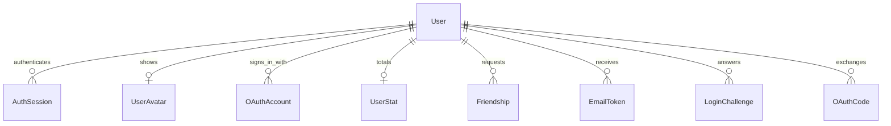

# WePomodoro backend

Express 5 + Prisma 7 + PostgreSQL. This single document covers setup, the HTTP
API, the data model, study-time accounting, and testing. The database holds
accounts, guests, friendships and lifetime statistics. **Rooms are not stored**:
a room (its code, timer, members, chat and minigames) lives only in memory in the
WebSocket layer, built separately, and disappears when the last person leaves.

Contents:

1. [Setup and running](#1-setup-and-running)
2. [Authentication](#2-authentication)
3. [API reference](#3-api-reference)
4. [Data model](#4-data-model)
5. [Study time and statistics](#5-study-time-and-statistics)
6. [Rooms, chat, minigames and the WebSocket layer](#6-rooms-chat-minigames-and-the-websocket-layer)
7. [Deletion and lifecycle](#7-deletion-and-lifecycle)
8. [Migrations](#8-migrations)
9. [Testing](#9-testing)
10. [Source map and frontend integration](#10-source-map-and-frontend-integration)

---

## 1. Setup and running

The API uses `backend/.env` (`DATABASE_URL`). Copy `.env.example` and fill it in.

```bash
cd backend
npm ci
npm run db:deploy   # applies committed migrations to DATABASE_URL
npm run dev         # generates the Prisma client, then starts tsx watch
```

`db:deploy` changes tables in the configured database; starting the API never
applies migrations. For a compiled run use `npm run build` then `npm start`.

To browse the database, run `make studio`
(opens on http://localhost:5555/).
Production transport should provide HTTPS so bearer tokens aren't sent in clear.

Environment variables:

| Variable                                                                         | Default                 | Meaning                                                              |
| -------------------------------------------------------------------------------- | ----------------------- | -------------------------------------------------------------------- |
| `DATABASE_URL`                                                                   | none (required)         | PostgreSQL connection string                                         |
| `PORT`                                                                           | `3000`                  | Listening port (1–65535)                                             |
| `CORS_ORIGIN`                                                                    | `http://localhost:5173` | Comma-separated exact origins allowed to call the API                |
| `OAUTH_REDIRECT_BASE`                                                            | `http://localhost:3000` | Public URL of this API; the provider callback URLs are built from it |
| `FRONTEND_URL`                                                                   | `http://localhost:5173` | Where the browser is sent after a provider sign-in (one origin)      |
| `GOOGLE_CLIENT_ID`, `GOOGLE_CLIENT_SECRET` (same for `GITHUB_` and `FORTY_TWO_`) | empty                   | Both set enables that provider; empty disables it                    |

Requests with no `Origin` header (curl, native clients) are accepted. A browser
`Origin` that isn't listed gets 403. CORS is not authentication.

With Docker Compose the backend runs as the unprivileged `node` user (uid 1000),
so files generated into the bind-mounted source tree (such as
`src/generated/prisma`) belong to your user, not root.

Shutdown (`SIGINT`/`SIGTERM`) stops the cleanup worker, closes idle keep-alive
connections, waits for an in-flight sweep, disconnects Prisma, and exits. If that
takes longer than 10 seconds the process exits with code 1.

---

## 2. Authentication

All endpoints live under `/api`; there are no root-path aliases. The only
non-`/api` route is `GET /`, which returns `{ service, health }`.

Login, and the last step of signup (`POST /api/auth/signup/verify`), return a
random `token`, its expiry, and a safe user profile. Guests receive a token and a
temporary guest profile. Send the token on later requests:

```http
Authorization: Bearer <token>
```

- Registered sessions last **7 days**, guest sessions **24 hours**.
- Only SHA-256 hashes of tokens are stored. Passwords use salted scrypt with
  constant-time comparison.
- Rate limits (per process, in memory): signup, login, guest creation and
  `POST /api/users` allow 20 requests per IP per minute, and login additionally
  allows 8 **failed** attempts per username per 15 minutes (successful logins
  don't count, and `Alice`/`alice` share one counter). Exceeding either returns
  429 with `Retry-After`. A multi-instance deployment should also enforce a
  shared limit at its gateway.
- Behind a reverse proxy set `TRUST_PROXY` to the number of proxies (0 when
  exposed directly). Too low makes all clients share the proxy's IP; too high
  lets clients spoof their IP with `X-Forwarded-For`.
- Existing profiles with a null `passwordHash` cannot password-login. Don't
  recreate accounts or let someone claim a passwordless profile by supplying its
  email; they need an explicit provisioning/recovery flow. New signups require a
  password.
- Accounts created through OAuth also have a null `passwordHash`: they can't
  password-login, and `PATCH /users/me` and the two-factor toggle (which ask for
  the current password) don't work for them until they add a password with the
  forgot-password flow.
- Registered logout revokes the current token. Guest logout **deletes** the guest
  (a guest keeps nothing: no stats, no friends). A guest whose tab closed without
  a clean logout is deleted by the realtime layer when its socket disconnects, or
  at the latest when its 24-hour expiry is swept.
- A worker removes expired auth sessions, guests, email tokens, login challenges,
  OAuth codes and pending signups every minute.

Input rules:

- Usernames: 3–32 letters, numbers, underscores or hyphens; lowercased. A real
  42 login is refused at password signup and username change when 42 is configured.
- Emails: valid format, at most 254 characters; trimmed and lowercased.
- Passwords: 8–128 characters; never trimmed. `currentPassword` and the password
  sent to `DELETE /api/users/me` are only checked for being a string of at most
  128 characters, so accounts with older, shorter passwords can still verify.
- Guest names: 1–32 characters after trimming. A name equal to a registered
  username (case-insensitive) or a real 42 login (see "Reserved 42 logins") is
  refused with 409, so a guest can't pose as that user.

---

## 3. API reference

**Base URL:** `http://localhost:3000/api`. Send JSON with
`Content-Type: application/json` (bodies are limited to 16 KB). Success responses
are JSON, except 204 which has no body. UUID placeholders need real IDs; user IDs
are integers.

Access labels: **Public** = no token; **Authenticated** = registered user or
guest; **Registered** = registered user; **Admin** = a registered user with the `ADMIN` role
(see 3.7).

### 3.1 Service and authentication

| Method | Endpoint                             | Access        | JSON body                             | Response                                                                                                                |
| ------ | ------------------------------------ | ------------- | ------------------------------------- | ----------------------------------------------------------------------------------------------------------------------- |
| GET    | `/api/health`                        | Public        | None                                  | 200 `{ status: "ok" }`; 503 if the database is unreachable or a committed migration isn't applied                       |
| POST   | `/api/auth/signup`                   | Public        | `{ "email", "username", "password" }` | 202 `{ pendingToken, expiresAt }`: nothing is created yet; a 6-digit code is emailed                                    |
| POST   | `/api/users`                         | Public        | Same signup body                      | 202: alias of signup with the same response                                                                             |
| POST   | `/api/auth/signup/verify`            | Public        | `{ "pendingToken", "code" }`          | 201 `{ token, expiresAt, user }`: creates the account (verified) and signs in; 400 for a wrong or expired code          |
| POST   | `/api/auth/signup/resend`            | Public        | `{ "pendingToken" }`                  | 202: emails a new code (3 per 15 minutes)                                                                               |
| POST   | `/api/auth/signup/cancel`            | Public        | `{ "pendingToken" }`                  | 204: discards the pending signup                                                                                        |
| POST   | `/api/auth/login`                    | Public        | `{ "username", "password" }`          | 200 `{ token, expiresAt, user }`; with two-factor on: `{ twoFactorRequired, challengeToken, expiresAt }` and no session |
| POST   | `/api/auth/login/2fa`                | Public        | `{ "challengeToken", "code" }`        | 200 `{ token, expiresAt, user }`; 401 on a wrong code                                                                   |
| POST   | `/api/auth/login/2fa/resend`         | Public        | `{ "challengeToken" }`                | 204: emails a new code (3 per 15 minutes per sign-in); 401 if the attempt expired                                       |
| POST   | `/api/auth/guest`                    | Public        | `{ "displayName" }`                   | 201 `{ token, guest: { id, displayName, expiresAt } }`                                                                  |
| GET    | `/api/auth/oauth`                    | Public        | None                                  | 200 `{ providers: ["google", ...] }`: the enabled providers                                                             |
| GET    | `/api/auth/oauth/:provider`          | Public        | None                                  | 302 to the provider and sets the `oauth_state` cookie; 404 for an unknown or disabled provider                          |
| GET    | `/api/auth/oauth/:provider/callback` | Public        | None                                  | 302 to `FRONTEND_URL/auth/oauth?code=…` or `?error=…`; never JSON                                                       |
| POST   | `/api/auth/oauth/exchange`           | Public        | `{ "code" }`                          | 200 `{ token, expiresAt, user }`; 401 for a used, unknown or expired code                                               |
| POST   | `/api/auth/password-reset/request`   | Public        | `{ "email" }`                         | 202 same message whether or not the account exists; emails a 6-digit code                                               |
| POST   | `/api/auth/password-reset/verify`    | Public        | `{ "email", "code" }`                 | 200 `{ resetToken, expiresAt }`; the code is spent                                                                      |
| POST   | `/api/auth/password-reset/confirm`   | Public        | `{ "resetToken", "password" }`        | 204; sets the password and signs out every session                                                                      |
| POST   | `/api/auth/verify-email`             | Registered    | `{ "code" }`                          | 204: confirms the address; sets `emailVerifiedAt`                                                                       |
| POST   | `/api/auth/verify-email/resend`      | Registered    | None                                  | 202: emails a new code (3 per 15 minutes); 409 if already verified                                                      |
| GET    | `/api/auth/me`                       | Authenticated | None                                  | 200 `{ type: "user" or "guest", profile }`                                                                              |
| POST   | `/api/auth/logout`                   | Authenticated | None                                  | 204: revoke the login, or delete the guest                                                                              |

### Two-factor authentication (email code)

Optional per account: once on, signing in also needs a six-digit code emailed to
the account's address (no authenticator app, no recovery codes). Intended UX:
after signup the client offers to turn it on (the user can skip), and a
registered user can turn it on or off later from their profile page. Turning it
on or off takes the account password **and** a code emailed to the account, in
two steps:

| Method | Endpoint                        | Body                     | Result                                             |
| ------ | ------------------------------- | ------------------------ | -------------------------------------------------- |
| GET    | `/api/auth/2fa`                 | None                     | `{ enabled }`                                      |
| POST   | `/api/auth/2fa/enable/request`  | `{ "password" }`         | 204: emails a code; 401 wrong password; 409 if on  |
| POST   | `/api/auth/2fa/enable`          | `{ "password", "code" }` | 204: now active                                    |
| POST   | `/api/auth/2fa/disable/request` | `{ "password" }`         | 204: emails a code; 401 wrong password; 409 if off |
| POST   | `/api/auth/2fa/disable`         | `{ "password", "code" }` | 204: off; pending sign-ins are cancelled           |

The confirming calls answer 400 for a wrong, expired, missing or locked code
(same message in every case) and 401 for a wrong password. A code lives 5
minutes, only the newest request for each action is valid, only its hash is
stored, and after 5 wrong guesses it is dead and a new one must be requested.
Codes are tied to their purpose: a sign-in code can't turn two-factor on or off,
nor the other way round. Guests get 403. Failed attempts on these four calls are
limited to 8 per 15 minutes per account.

Once on, `POST /api/auth/login` answers a correct password with
`{ twoFactorRequired: true, challengeToken, expiresAt }` instead of a session and
emails a code. The client then calls `POST /api/auth/login/2fa` with that token and
the `code` within 5 minutes. A wrong code answers 401 and five wrong codes cancel
the challenge (sign in again); a used challenge is gone, so a code works once.
`POST /api/auth/login/2fa/resend` emails a new code for a live challenge (the old
code stops working): the expiry and the count of wrong guesses are kept, so a
resend gives no extra guesses, and resends are limited to 3 per 15 minutes per
sign-in. Password reset ends all sessions but leaves two-factor on, and an
administrator can switch it off for a user who lost access to their email. The
codes are sent through the `Mailer` (see below), so in production every
two-factor sign-in depends on email delivery.

The health check compares the `prisma/migrations` folders with the database's
`_prisma_migrations` table, so a forgotten `db:deploy` shows up as 503. If the
folder isn't shipped with the build the comparison is skipped.
Authentication runs before protected routing, so unknown paths without a valid
token may return 401 before 404.

### Sign in with OAuth (Google, GitHub, 42)

Optional per provider: one whose client id and secret are empty is disabled.
Signup and login are the same flow, because the backend decides between them.

1. The frontend sends the browser (a full page navigation, not `fetch`) to
   `GET /api/auth/oauth/:provider`. The API sets an `oauth_state` cookie (random,
   `HttpOnly`, `SameSite=Lax`, scoped to `/api/auth/oauth`, 10 minutes, `Secure`
   in production) and redirects to the provider.
2. The provider redirects to `GET /api/auth/oauth/:provider/callback?code&state`.
   The API compares `state` with the cookie, swaps the code for a token, reads
   the profile (`fetch`, 5 second timeout), finds or creates the user and issues
   a **one-time code** (60 seconds, stored hashed in `OAuthCode`). The callback
   is a page navigation, so it always redirects to the frontend:
   `FRONTEND_URL/auth/oauth?code=…` on success, `?pending=<pendingToken>` when the
   email still has to be proven (see below), or `?error=…` on failure
   (`state`, `denied`, `no_email`, `email_taken`, `failed`).
3. The frontend sends the code to `POST /api/auth/oauth/exchange` and receives
   `{ token, expiresAt, user }`, like a successful password login. A code works
   once. The session token never appears in a URL.

Which user the sign-in resolves to:

- A linked identity, matched by `(provider, providerUserId)` only (never by email
  after the first link), signs in as its user.
- Otherwise, if the provider **vouches for the email** (Google `email_verified`,
  GitHub's primary verified email): an existing account with that email that is
  verified gets the provider linked; an existing **unverified account** is never
  taken over (the redirect carries `error=email_taken`). With no
  existing account a new one is created, already verified.
- If the provider **doesn't vouch** for the email (42, or GitHub without a
  verified email): the email is never linked to an existing account
  (`error=email_taken`). No account is created yet: a pending signup is stored,
  the six-digit code is emailed and the callback redirects with `?pending=…`. The
  frontend asks for the code and calls `POST /api/auth/signup/verify`, exactly
  like a password signup.
- A new username comes from the provider's login (lowercased, other characters
  replaced by `_`); on a clash a random four-character suffix is added.

Reserved 42 logins: when 42 is configured, a username that is a real 42 login
(checked with `GET /v2/users/<login>` using the app's own token) is refused with
`409 That name belongs to a 42 account; sign in with 42 instead` at password
signup, username change and guest creation. Google and GitHub sign-ins whose
login is a real 42 login get a random suffix. A 42 sign-in is never blocked.
Answers are cached 10 minutes (5000 names, per process). If 42 can't be reached
the check is skipped (fail open) and the error is logged. Admin-created users
aren't checked.

OAuth login does not ask for the email two-factor code: the provider is the
second factor. A user with a password and two-factor who also linked a provider
can therefore sign in with the provider without the code. OAuth-only accounts
have no password (see section 2).

The `/api/auth/oauth` routes are limited to 20 requests per IP per minute, for
every method (the signup and login limiter only counts `POST`). Provider
failures (timeout, non-2xx, malformed answer) become `error=failed` and are
logged.

### Email verification

Signup does **not** create the account. `POST /api/auth/signup` stores a
`PendingSignup` and emails a six-digit code (valid 10 minutes, newest only, 5
wrong guesses kill it, 3 resends per 15 minutes). `POST /api/auth/signup/verify`
with the `pendingToken` and the code creates the `User` (already verified) and
its session in one step, so nobody can hold an address or username they don't
own. A pending signup that is never completed is removed by the minute-by-minute
cleanup when its code expires. Password signup replaces a pending signup on the
same email, so the address's real owner is not locked out; existing accounts are
never replaced. The sign-in and reset emails also say to reset the password (Sign In, then
Forgot password) at `FRONTEND_URL` if the reader didn't ask.

An account can still become **unverified** later: changing the email through
`PATCH /api/users/me` clears `emailVerifiedAt`, emails a code to the new address
and calls for `POST /api/auth/verify-email`. Verification is **enforced**: until
`emailVerifiedAt` is set, a registered account's token only works on
`GET /auth/me`, `POST /auth/logout`, `POST /auth/verify-email`,
`POST /auth/verify-email/resend`, and `GET`/`PATCH`/`DELETE /users/me` (so a
mistyped address can be fixed or the account deleted). Everything else answers
403 `Verify your email address first`. Guests have no email and are not affected.
`/auth/me` and the profile endpoints include `emailVerifiedAt`.

### Password recovery flow

1. The user enters their email. `request` always answers 202 with the same
   message, so addresses can't be discovered. If an account has that email, a
   six-digit code is emailed. It expires in 15 minutes, only the newest request
   is valid, and only its hash is stored. Requests are limited to 3 per address
   per 15 minutes.
2. The user enters the code. `verify` returns 400 for a wrong, expired or
   reused code (same message in every case). After 5 wrong guesses that code is
   dead and a new one must be requested. A correct code is spent and a random
   `resetToken` (valid 15 minutes) is returned; the frontend then shows the
   new-password form.
3. `confirm` sets the new password (8–128 characters) in one transaction,
   marks the token used, and deletes all of the user's login sessions and 2FA
   login challenges. A token works once, and stops working if the account's
   email changed after it was issued.

Email is sent through the `Mailer` in `src/mail/mailer.ts`. With `SMTP_USER` and
`SMTP_PASSWORD` set, `src/mail/smtp.ts` sends it over SMTP (Gmail by default);
otherwise the API falls back to `consoleMailer`, which only logs the message and
is fine for development. In production the API refuses to start without SMTP
settings. At startup it checks the SMTP login and logs `Email ready: sending as
…` or the error. Gmail needs 2-Step Verification and an
[App Password](https://myaccount.google.com/apppasswords); it caps ordinary
accounts at roughly 500 messages a day. Note that lookup is by the stored email, which new signups
lowercase; a migration lowercased older mixed-case emails (skipping any that
would collide with another account).

### 3.2 Users and statistics

| Method | Endpoint              | Access        | Body / query                                    | Response                                     |
| ------ | --------------------- | ------------- | ----------------------------------------------- | -------------------------------------------- |
| GET    | `/api/users`          | Authenticated | Optional `skip`, `take`                         | 200 array of `{ id, username }`; no emails   |
| GET    | `/api/users/me`       | Registered    | None                                            | 200 own profile                              |
| PATCH  | `/api/users/me`       | Registered    | At least one of `username`, `email`, `password` | 200 updated profile                          |
| DELETE | `/api/users/me`       | Registered    | `{ "password" }`                                | 204: delete the account and everything of it |
| GET    | `/api/users/me/stats` | Registered    | None                                            | 200 `{ focusedSeconds, wins, losses }`       |

Profiles contain `id`, `username`, `email`, `emailVerifiedAt` and `role`. Password
hashes, token hashes and other users' emails are never returned. Personal
endpoints always derive the user ID from the token, never from the body or query.

Changing email or password requires `currentPassword`; a username-only change
does not. A password change revokes all other login sessions and keeps the
current token valid.

```json
{
  "email": "new@example.com",
  "password": "new-long-password",
  "currentPassword": "previous-password"
}
```

Deleting an account requires its password and removes everything that belongs to
it through foreign keys: logins, avatar, OAuth links, friendships and statistics.
Whoever is in a room at that moment is not stored anywhere on the database side;
the realtime layer is told through `ctx.realtime.eject` (see section 6).

Statistics response (the only three numbers kept; `wins` and `losses` are all
minigames together):

```json
{ "focusedSeconds": 1800, "wins": 3, "losses": 2 }
```

A new account returns zeros. Guests have no stats.

### 3.2a Avatars and public profiles

| Method | Endpoint                | Access        | Body / query                                        | Response                                                 |
| ------ | ----------------------- | ------------- | --------------------------------------------------- | -------------------------------------------------------- |
| PUT    | `/api/users/me/avatar`  | Registered    | Raw image, `Content-Type` PNG/JPEG/WebP, max 512 KB | 204; replaces the old picture                            |
| DELETE | `/api/users/me/avatar`  | Registered    | None                                                | 204: back to the default                                 |
| GET    | `/api/users/:id/avatar` | **Public**    | None                                                | The image; a neutral default SVG if none or no such user |
| GET    | `/api/users/:id`        | Authenticated | None                                                | 200 public profile; 404 if unknown                       |

**Avatar upload.** Send the file itself as the body, not JSON:
`fetch(url, { method: "PUT", headers: { Authorization, "Content-Type": file.type }, body: file })`.
The bytes must really be the declared format (415 for another type, 400 for a
mismatch, 413 above 512 KB). SVG is refused because it can carry scripts. Images
live in the `UserAvatar` table, so no file volume is needed. Use
``: the route needs no token and sends
`Cross-Origin-Resource-Policy: cross-origin` so the frontend origin can show it.
It is cached for 60 s, so add `?v=<timestamp>` after an upload to see it at once.

**Public profile.** `{ id, username, focusedSeconds, wins, losses,
friendship }` — never the email. `friendship` is `null`,
or `{ id, status, direction }` (`direction` is `outgoing` if you asked,
`incoming` if they did) so the page can offer add, accept or remove; it is null
for yourself and for guests.

### 3.2b Friends

Registered users only. A request is accepted by the other person, or
automatically if they had already asked you.

| Method | Path                      | Body             | Result                                    |
| ------ | ------------------------- | ---------------- | ----------------------------------------- |
| GET    | `/api/friends`            | None             | `{ friends, incoming, outgoing }`         |
| POST   | `/api/friends`            | `{ "username" }` | 201 request (or accepted crossed request) |
| POST   | `/api/friends/:id/accept` | None             | 204; only the addressee                   |
| DELETE | `/api/friends/:id`        | None             | 204: decline, cancel or unfriend          |

Each entry of `GET /api/friends` is `{ id, user: { id, username } }`; accepted
friends also carry `presence: { online, roomCode }`. Presence is **not stored**:
it comes from the WebSocket layer through `ctx.realtime.presence(userId)`. Until
that hook is plugged in everybody is `{ online: false, roomCode: null }`. A friend
with a `roomCode` can be joined from the friends page: the frontend sends you to
`/room/<roomCode>`. Friend direct messages are not built.

### 3.3 Rooms are not in the API

There are no room, session or timer endpoints. A room is created, joined and
destroyed over WebSocket and kept in memory only: a 8-character case-sensitive
code, the study and break durations, the shared timer and the people in it. It
has **no owner** (everybody has the same rights) and disappears when the last
person leaves. Guests and registered users can both create and join rooms.

What the HTTP API provides for rooms is the identity (the same Bearer token
authenticates the socket) and two server-side functions the realtime layer calls;
see sections 5 and 6.

### 3.4 Chat and minigames

There are no chat or minigame endpoints. Chat messages and live game state live
in memory in the WebSocket server (built by a teammate), so nothing is kept when
someone leaves or reconnects. See [section 6](#6-rooms-chat-minigames-and-the-websocket-layer).

### 3.5 Pagination and errors

`/api/users` accepts `?skip=0&take=20`. `skip` is an integer 0–1000000, `take` an integer
1–100. Invalid, negative, fractional or repeated values return 400. Responses are
plain arrays with no total-count envelope.

Errors are JSON, for example `{ "error": "A valid Bearer token is required" }`.

| Status | Meaning                                                                                 |
| ------ | --------------------------------------------------------------------------------------- |
| 400    | Invalid JSON, body, pagination, UUID or action input                                    |
| 401    | Missing/invalid/expired token, failed login, or incorrect password                      |
| 403    | Insufficient permissions, guest using a registered endpoint, or rejected browser origin |
| 404    | Missing record or endpoint                                                              |
| 409    | Duplicate value or concurrent change                                                    |
| 413    | JSON body exceeds 16 KB                                                                 |
| 429    | Authentication attempt limit exceeded                                                   |
| 500    | Unexpected server error; internal details are not returned                              |

### 3.6 Examples

```bash
curl -X POST http://localhost:3000/api/auth/signup \
  -H 'Content-Type: application/json' \
  -d '{"email":"learner@example.com","username":"learner","password":"a-long-local-password"}'
# then, with the emailed code:
curl -X POST http://localhost:3000/api/auth/signup/verify \
  -H 'Content-Type: application/json' \
  -d '{"pendingToken":"PENDING_TOKEN","code":"123456"}'

curl -X POST http://localhost:3000/api/auth/guest \
  -H 'Content-Type: application/json' \
  -d '{"displayName":"Anon"}'
```

Both flows return a token; use it as `Authorization: Bearer <token>` (and to
authenticate the WebSocket).

### 3.7 Administration and roles

Site-wide roles (`User.role`, shown in `/auth/me`):

| Role    | Can do                                                                                                                        |
| ------- | ----------------------------------------------------------------------------------------------------------------------------- |
| `USER`  | Everything normal.                                                                                                            |
| `ADMIN` | User management and deleting guests and accounts below. The frontend shows it as a card in the profile page, only for admins. |

Nobody is admin by default. Make the first one on the server, then promote others
through the API:

```bash
npm run users:role -- alice admin    # or: user
```

All `/api/admin/*` routes need a verified admin account (403 otherwise). A
deleted person gets 401 on their next request, which is what sends the frontend
to the "ejected" notification; the live removal from the room is `ctx.realtime.eject`.

| Method | Endpoint                   | Body / query                                            | Response                                                                                                  |
| ------ | -------------------------- | ------------------------------------------------------- | --------------------------------------------------------------------------------------------------------- |
| GET    | `/api/admin/users`         | `skip`, `take`, optional `q` (name or email)            | 200 users: admins get `email`, `emailVerifiedAt`, `twoFactorEnabled` too                                  |
| GET    | `/api/admin/users/:id`     | None                                                    | 200 one user (same views); 404                                                                            |
| POST   | `/api/admin/users`         | `{ username, email, password, role? }`                  | 201 user; the email counts as verified; 409 if taken                                                      |
| PATCH  | `/api/admin/users/:id`     | At least one of `username`, `email`, `password`, `role` | 200 updated user                                                                                          |
| DELETE | `/api/admin/users/:id`     | None                                                    | 204: deletes the account (its logins die at once) and ejects the person from their room; 409 for yourself |
| DELETE | `/api/admin/users/:id/2fa` | None                                                    | 204: switches two-factor off (lost email access); 404 if not on                                           |
| GET    | `/api/admin/guests`        | None                                                    | 200 `[{ id, displayName }]`: the guests that exist now (up to 500)                                        |
| DELETE | `/api/admin/guests/:id`    | None                                                    | 204: deletes the guest (its token dies at once) and ejects it from its room; 404                          |

Passwords can be **set** but never read: only a one-way scrypt hash is stored.
Setting one (on create or `PATCH`) signs that user out of every session and
cancels pending 2FA logins; tell them the new password out of band and have them
change it. A changed email is unverified again and gets a code. Removing or
demoting the last administrator returns 409.

---

## 4. Data model

Eleven PostgreSQL tables. `LoginChallenge` backs two-factor login;
`OAuthAccount` and `OAuthCode` back OAuth sign-in; `PendingSignup` holds a signup
until its emailed code is entered. **Rooms, timers, memberships, chat, presence
and minigames have no tables**: they live in the WebSocket layer. The only thing
a room leaves behind is study time, added to `UserStat`.

| Table            | Purpose                                                                | Main relationships                                                          |
| ---------------- | ---------------------------------------------------------------------- | --------------------------------------------------------------------------- |
| `User`           | Registered profile and optional password hash                          | Has logins, friendships and one `UserStat`                                  |
| `AuthSession`    | A registered user's login, identified by a hashed token with an expiry | Belongs to one user                                                         |
| `UserAvatar`     | Profile picture bytes (PNG/JPEG/WebP, max 512 KB)                      | One per user; deleted with the account                                      |
| `GuestSession`   | Temporary guest identity: display name, hashed token and expiry        | None; keeps no stats                                                        |
| `UserStat`       | Lifetime study seconds, minigame wins and losses of a registered user  | One per user; deleted with the account                                      |
| `EmailToken`     | One-time email codes: verification, password reset, 2FA on/off         | Belongs to one user                                                         |
| `LoginChallenge` | Short-lived step between password and session; holds the code's hash   | Belongs to one user                                                         |
| `OAuthAccount`   | A Google, GitHub or 42 identity linked to a user                       | Belongs to one user; unique per provider identity and per user and provider |
| `OAuthCode`      | One-time code (about a minute) swapped for a session after OAuth       | Belongs to one user                                                         |
| `Friendship`     | A friend request between two registered users, pending or accepted     | Two users                                                                   |
| `PendingSignup`  | A signup waiting for its emailed code; becomes a `User` when proven    | None                                                                        |



`GuestSession` and `PendingSignup` stand alone: a guest is not linked to anything
and is deleted when it leaves.

### Reading the schema

- `Int` is a PostgreSQL integer; `String` is text unless marked `@db.Uuid`.
- `DateTime` is a timestamp, exposed by the API as an ISO string. Use server
  timestamps for accounting and format for the user's timezone in the frontend.
- `?` means nullable; `[]` is a collection of related records.
- `@default(uuid())` generates UUIDs in Prisma. Direct SQL inserts must supply
  UUID IDs because the migrations don't create a database default.
- `@updatedAt` is maintained by Prisma, not a trigger; direct SQL updates must set
  it themselves.
- Fields such as `user`, `requester` and `addressee` are **Prisma relation
  fields**, not columns. The foreign-key column is, for example, `userId`.

### Design choices

- The integer `User.id`, email and username were preserved. The `createdAt` and
  `updatedAt` columns of `User` and the `createdAt` of `GuestSession` were
  dropped because nothing reads them; the other tables keep their `createdAt`
  where an expiry or a cleanup depends on it.
- Guests are separate from users, so no fake email or nullable email is needed.
  A guest can create and join rooms, but nothing of a guest is kept: it has no
  `UserStat`, no friends, and its row is deleted when it leaves.
- Rooms are never stored. The code, the durations, the timer and the member list
  exist only in the realtime layer, so there is nothing to clean up in the
  database when a room ends.
- Study time is added to `UserStat.focusedSeconds` by the realtime layer when a
  registered person leaves a room or closes the tab, so reading stats needs no
  history.
- Leaderboards are intentionally deferred. Friend direct messages are not built.

### 4.1 User

A permanent registered account. Guests have no `User` row.

| Field                | Type        | Default / rule             | Meaning                                                                             |
| -------------------- | ----------- | -------------------------- | ----------------------------------------------------------------------------------- |
| `id`                 | `Int`       | Primary key; autoincrement | Stable registered-user identity                                                     |
| `email`              | `String`    | Unique; required           | Contact address; API trims/lowercases new values                                    |
| `username`           | `String`    | Unique; required           | Public name; API lowercases new values                                              |
| `passwordHash`       | `String?`   | Null if omitted            | Salted scrypt hash; never a plain password; null for OAuth-only accounts            |
| `emailVerifiedAt`    | `DateTime?` | Null until verified        | When the owner proved control of `email`; clear on change                           |
| `twoFactorEnabledAt` | `DateTime?` | Null = off                 | When emailed-code two-factor was turned on; sign-in asks for a code while it is set |
| `role`               | `Role`      | `USER`                     | `USER` or `ADMIN`; set with `npm run users:role`, then via the admin API            |

Relations: `authSessions`, `emailTokens`, `loginChallenges`, `oAuthAccounts`, `oAuthCodes`, `avatar`, `stat` and the two friendship sides. A null hash preserves pre-existing
profiles and OAuth-only accounts and never grants password login. Database uniqueness is case-sensitive; API normalization applies to new
writes and does not rewrite older records.

`UserAvatar`: `userId` (primary key, cascade), `contentType` (SQL allows only the
three image types), `data` (1 byte to 512 KB, enforced by CHECK), `updatedAt`.

### 4.2 AuthSession

One registered login; several allow multiple devices.

| Field       | Type          | Default / rule                   | Meaning                                 |
| ----------- | ------------- | -------------------------------- | --------------------------------------- |
| `id`        | UUID `String` | Primary key; `uuid()`            | Login session ID                        |
| `userId`    | `Int`         | Required foreign key → `User.id` | Authenticated account                   |
| `tokenHash` | `String`      | Unique; required                 | SHA-256 hash of the random bearer token |
| `expiresAt` | `DateTime`    | Required; after `createdAt`      | Token validity deadline                 |
| `createdAt` | `DateTime`    | `now()`                          | Creation time                           |

Indexes on `userId` and `expiresAt` support lookups and cleanup. Signup/login
generate a random token, store only its hash and return the raw token once.
Authentication hashes the presented token and **also checks expiry**: a row
existing is not enough.

### 4.3 GuestSession

A temporary identity for visitors without an account.

| Field         | Type          | Default / rule                    | Meaning                        |
| ------------- | ------------- | --------------------------------- | ------------------------------ |
| `id`          | UUID `String` | Primary key; `uuid()`             | Guest identity                 |
| `displayName` | `String`      | Required; SQL rejects blank names | Name shown to other people     |
| `tokenHash`   | `String`      | Unique; required                  | Hash of the guest bearer token |
| `expiresAt`   | `DateTime`    | Required                          | Safety-net deadline (24 hours) |

A guest is deleted as soon as it leaves: on logout, or when the realtime layer
sees its socket close (after a short grace period so a page reload does not log
it out). `expiresAt` only catches the ones that were never closed cleanly; the
cleanup that runs every minute removes them. A guest can create and join rooms
but keeps no stats, no friends and no minigame results; there is no
guest-to-account transfer. Index: `expiresAt`.

### 4.4 UserStat

`userId` (primary key, cascade), `focusedSeconds`, `wins`, `losses` (all default
0, CHECKed nonnegative). Only registered users have a row; it is created on first
credit or result. Wins and losses are all minigames together; there is no
per-game or per-room history. This is the **only** place study time lives.

### 4.5 Account recovery, two-factor, OAuth and signup tables

`EmailToken` backs email verification, password reset and the codes for turning
two-factor on or off; `LoginChallenge` backs two-factor sign-in; `OAuthAccount`
and `OAuthCode` back OAuth sign-in; `PendingSignup` holds a signup (or an OAuth
sign-in whose email isn't vouched for) until its emailed code is entered. Every
table except `PendingSignup` cascades on user deletion, and tokens are stored as
hashes, as with `AuthSession`.

- **`EmailToken`**: `purpose` is `EMAIL_VERIFICATION`, `PASSWORD_RESET_CODE` (the emailed six-digit code) `PASSWORD_RESET` (the long token a verified code is exchanged for), `TWO_FACTOR_ENABLE_CODE` or `TWO_FACTOR_DISABLE_CODE` (emailed six-digit codes; the hash includes the user and the action). `failedAttempts` counts wrong guesses at a code. It
  stores the address the link was sent to (`email`), so a verification only
  counts while it still equals `User.email`. `tokenHash` is unique, `expiresAt`
  must be after `createdAt`, and `usedAt` marks consumption (never accept a used
  token). Indexed by `(userId, purpose)` and `expiresAt` for cleanup.
- **`LoginChallenge`**: created after a correct password when 2FA is enabled.
  The client holds the raw token and must present the emailed code with it before
  receiving a session. `codeHash` is the hash of that code (it includes the user
  and the purpose `login`) and is replaced by a resend. `expiresAt` is minutes,
  not days, and is the code's expiry too; `failedAttempts` lets the service
  delete the challenge after a few misses.
- **`OAuthAccount`**: links a user to a provider identity. `provider` is the enum
  `OAuthProvider` (`GOOGLE`, `GITHUB`, `FORTY_TWO`) and `providerUserId` is the
  provider's stable id as text (Google `sub`, the numeric GitHub and 42 ids).
  Unique `(provider, providerUserId)` means one identity belongs to one user;
  unique `(userId, provider)` means a user links each provider at most once.
  Sign-in looks the identity up by this pair and never by email.
- **`OAuthCode`**: the one-time code that replaces a session token in the
  redirect URL. `codeHash` is unique, `expiresAt` is about a minute, and the row
  is deleted when exchanged (single use); expired rows are swept by
  `cleanupExpiredSessions`.

- **`PendingSignup`**: `tokenHash` (the `pendingToken` the client holds), `email`,
  `username`, `passwordHash` or the OAuth `provider` and `providerUserId`,
  `codeHash`, `failedAttempts`, `resends` with `resendWindowAt`, and
  `expiresAt` (10 minutes). Completing it creates the `User`; expired rows are swept
  by `cleanupExpiredSessions`.

Password reset creates a `PASSWORD_RESET` token; consuming it sets a new hash, deletes
the user's `AuthSession` rows and login challenges, and marks the token used, in one
transaction. Reset requests answer identically whether or not the email exists.
Verification sets `emailVerifiedAt`; changing the email clears it. Expired tokens
and challenges are removed by `cleanupExpiredSessions`.

### 4.6 Friends

`Friendship`: `requesterId` → `addresseeId`, `status` `PENDING`/`ACCEPTED`,
`createdAt`. Both users cascade. SQL rejects a friendship with
yourself and a second row for the same pair in either direction. Declining,
cancelling and unfriending delete the row.

---

## 5. Study time and statistics

The backend has **no timer**. The shared timer and the rooms belong to the
WebSocket layer; the backend only stores what a room produces, through two
internal functions in `src/stats/stats.service.ts`. They are not HTTP endpoints,
so a client can never credit itself.

- `addFocusedSeconds(ctx, userId, seconds)`: adds `seconds` (an integer 0 to 86400) to `UserStat.focusedSeconds`. The realtime layer calls it **once** when a
  registered person leaves a room or closes the tab, with the focus seconds it
  measured (a longer stay is split into calls of at most 86400). Guests are never
  credited. If the account was deleted meanwhile, nothing is written.
- `recordMatch(ctx, winnerId, loserId)`: adds one win and one loss in one
  transaction; a `null` id (a guest) is skipped. The game server calls it when a
  match finishes; draws do not exist.
- `getUserStatistics(db, userId)`: `{ focusedSeconds, wins, losses }`, zeros for
  a new account, `null` for an unknown user. Breaks never count toward focus and
  guests never appear in statistics.

## 6. Rooms, chat, minigames and the WebSocket layer

Rooms, chat, minigames and the "online" state are not stored in the database and
have no HTTP endpoints. A teammate is building the WebSocket server for them.
This is the contract between it and the API:

- **Authentication.** The socket uses the same Bearer token as HTTP: hash it with
  `tokenHash` (`auth.service.ts`) and look it up in `AuthSession` or
  `GuestSession`, checking `expiresAt`, like `authenticate()`.
- **Rooms** are created and destroyed by the socket server only, in memory, with
  an 8-character case-sensitive code, the study and break durations, no owner,
  and the shared timer. A joiner syncs to the current phase.
- **Study time**: call `addFocusedSeconds` on leave or disconnect (section 5).
- **Guests**: when a guest's socket closes, delete it after a short grace period
  with `endIdentity(ctx, { userId: null, guestSessionId })`
  (`src/api/lifecycle.ts`).
- **Presence and ejection.** Set `ctx.realtime` when the socket server starts:

  ```ts
  ctx.realtime = {
    presence: (userId) => ({ online: boolean, roomCode: string | null }),
    eject: ({ userId, guestSessionId }) => {
      /* leave the room, close the socket */
    },
  };
  ```

  `presence` feeds `GET /api/friends`. `eject` is called by the admin delete
  endpoints after the database row is gone. Both hooks are optional: without them
  everybody is offline and nobody can be ejected live.

- **Chat** is per room and in memory only: nobody who leaves or disconnects gets
  earlier messages back.
- **Minigames** run on the server, which decides the winner and then calls
  `recordMatch` (section 5). Only registered players keep a win or loss.
- **Online/presence** is the socket connection. There is no `Presence` table.

---

## 7. Deletion and lifecycle

| Parent action       | Database behavior                                                      | Implemented API behavior                                                          |
| ------------------- | ---------------------------------------------------------------------- | --------------------------------------------------------------------------------- |
| Delete User         | Cascade logins, avatar, OAuth links and codes, friendships, `UserStat` | Self-delete or admin delete; the realtime layer ejects them from their room       |
| Delete GuestSession | The row is simply removed                                              | Logout, admin delete, socket disconnect, or the expiry sweep; admin delete ejects |

Expiry is not an automatic SQL deletion. Authentication checks it on every
request and `cleanupExpiredSessions()` (every minute) removes expired auth
sessions, guests, email tokens, pending signups, login challenges and OAuth
codes.

### Application rules the schema can't enforce

Identity types (a request acts as a registered user **or** a guest, never both),
expiry, the verified-email gate, the admin role and the "last administrator must
remain" rule live in the services. Foreign keys alone do not enforce these
permissions, so preserve the service checks when adding endpoints. Critical
writes use serializable transactions with retries on Prisma `P2034`; multi-record
operations are atomic.

---

## 8. Migrations

`schema.prisma` describes the models, while hand-written SQL in the migrations
adds the CHECK constraints and partial unique indexes. Preserve them
in future migrations. `prisma db push` is not a substitute.

| Migration                               | Contents                                                                                                                                                                                                                                                                                                                     |
| --------------------------------------- | ---------------------------------------------------------------------------------------------------------------------------------------------------------------------------------------------------------------------------------------------------------------------------------------------------------------------------- |
| `20261001114431_init`                   | Original `User` table                                                                                                                                                                                                                                                                                                        |
| `20261001115727_remove_password`        | Drops the old plain `password` column                                                                                                                                                                                                                                                                                        |
| `20261006160000_study_platform`         | Nullable `User.passwordHash`, the other 8 tables, enums, indexes, FKs, CHECKs, partial index                                                                                                                                                                                                                                 |
| `20261006170000_timer_accounting`       | `resumedAt`, `creditedAt`, timestamp CHECKs, `(status, startedAt)` index                                                                                                                                                                                                                                                     |
| `20261007140000_account_recovery_2fa`   | `User.emailVerifiedAt`; `EmailToken`, `TwoFactor`, `RecoveryCode`, `LoginChallenge` with CHECKs                                                                                                                                                                                                                              |
| `20261007160000_password_reset_code`    | `PASSWORD_RESET_CODE` purpose, `EmailToken.failedAttempts` and its CHECK                                                                                                                                                                                                                                                     |
| `20261009120000_personal_invites`       | `Invite`; existing room codes become the owner's code; drops `StudyRoom.inviteCode`                                                                                                                                                                                                                                          |
| `20261009130000_servers_friends_chat`   | Drops `RoomMember.leftAt` (deleting rows that had left); `Friendship`, `Message` with CHECKs                                                                                                                                                                                                                                 |
| `20261009140000_presence_join_requests` | `Presence`, `JoinRequest` with CHECK                                                                                                                                                                                                                                                                                         |
| `20261009150000_member_invited_by`      | `RoomMember.invitedById`                                                                                                                                                                                                                                                                                                     |
| `20261013120000_moderation`             | `RoomMember.mutedUntil`; `RoomBan`                                                                                                                                                                                                                                                                                           |
| `20261013120100_lowercase_emails`       | Lowercases old mixed-case emails unless that would collide with another account                                                                                                                                                                                                                                              |
| `20261013130000_signup_verify_deadline` | `User.verifyBy`                                                                                                                                                                                                                                                                                                              |
| `20261013140000_message_is_guest`       | `Message.isGuest`                                                                                                                                                                                                                                                                                                            |
| `20261113120000_room_code`              | `StudyRoom.code` (backfilled); drops `Invite`, `RoomBan`, `JoinRequest`, `RoomMember.invitedById`                                                                                                                                                                                                                            |
| `20261013150000_avatar_roles`           | `Role` enum and `User.role`; `UserAvatar` with size and type CHECKs                                                                                                                                                                                                                                                          |
| `20261015080914_email_2fa`              | `User.twoFactorEnabledAt`, `LoginChallenge.codeHash`; drops `TwoFactor`, `RecoveryCode`                                                                                                                                                                                                                                      |
| `20261013160000_moderator_role`         | Adds `MODERATOR` to `Role`                                                                                                                                                                                                                                                                                                   |
| `20261021085625_oauth`                  | `OAuthAccount`, `OAuthCode`, `OAuthProvider`                                                                                                                                                                                                                                                                                 |
| `20261106120000_pending_signup`         | `PendingSignup`: a signup becomes a `User` only when its emailed code is entered                                                                                                                                                                                                                                             |
| `20261116120000_session_model`          | `StudyRoom`+`PomodoroSession`+`RoomMember`+`SessionParticipant` become `PomodoroSession`+`SessionMember`; `UserStat` (filled from old attendance); drops `Message`, `Presence`, `MiniGame`, `GameResult`, `User.verifyBy`, `Friendship.respondedAt`, closed rooms and the long-break settings; phases become `FOCUS`/`BREAK` |
| `20261124120000_ephemeral_rooms`        | Drops `SessionMember`, `PomodoroSession`, `TimerStatus` and `PomodoroPhase` (rooms are no longer stored); drops `GuestSession.createdAt` with its expiry CHECK, and `User.createdAt` and `User.updatedAt`                                                                                                                    |
| `20261126120000_drop_moderator_role`    | Removes `MODERATOR` from `Role` (moderators become `USER`)                                                                                                                                                                                                                                                                   |

The study-platform migration preserves existing profiles and never drops user
data. `UserStat` keeps the study time that the removed room tables once held.

```bash
npm run db:validate   # validate schema
npm run db:deploy     # apply committed migrations (explicit; changes DATABASE_URL's DB)
npm run db:generate   # regenerate the client; does not touch the database
npm run db:migrate -- --name describe_the_change   # new migration on a dev DB
```

Client generation runs automatically before dev, build and tests. Don't edit
deployed migrations; add a new one.

Future features should add models when concrete: direct messages (they need the
WebSocket layer).

---

## 9. Testing

```bash
cd backend
npm run test:db:up      # disposable PostgreSQL 17 on 127.0.0.1:55432
npm test                # API + database suites, sequentially
npm run test:types
npm run lint
npm run format:check
npm run test:db:down
```

`npm run test:api` and `npm run test:db` run the suites separately. The test
database is `wepomodoro_test` on ephemeral storage. The runner never falls back
to `DATABASE_URL`; an optional `TEST_DATABASE_URL` must point to localhost and
that exact database name, without query options. Committed migrations are
applied before fixtures run. Database cases roll back after each test; API tests
serve Express on an ephemeral loopback port, use a controlled clock (no sleeping)
and clean their own fixtures.

Coverage includes email-code two-factor (turning it on and off, sign-in
codes, resend, attempt limits and expiry), OAuth sign-in against fake providers
(state cookie and mismatch, first sign-in, replay and expiry of the one-time
code, unverified provider emails, linking, pending signups, username clashes, no
password login for OAuth-only accounts), reserved 42 logins (signup, guest,
rename, fail open, cache, Google suffix), pending signups replaced by the email's
owner, guests (created, deleted on logout and by the expiry sweep), friends and
their presence from the realtime hook, study time added with
`addFocusedSeconds` (and never written for a deleted account), `recordMatch`,
the admin lists and deletes of guests and accounts with the eject hook (plain
users and guests get 403), the `USER`/`ADMIN` role enum, the absence of any room
table, unique constraints, deletion cascades, legacy-user migration preservation and
secret-field exclusion. CI runs the full suite against its own PostgreSQL
service.

---

## 10. Source map and frontend integration

| File                                        | Role                                                               |
| ------------------------------------------- | ------------------------------------------------------------------ |
| `src/index.ts`                              | Startup, cleanup worker, graceful shutdown                         |
| `src/app.ts`                                | Injectable Express app, CORS, JSON parsing, consistent errors      |
| `src/api/router.ts`                         | The endpoint contract above                                        |
| `src/api/common.ts`                         | Validation, identity types, realtime hooks, serializable retries   |
| `src/api/lifecycle.ts`                      | Logout, account deletion, expiry cleanup (guests included)         |
| `src/auth/auth.service.ts`                  | Passwords, token issuance/authentication, guests, profiles         |
| `src/auth/pending.service.ts`               | Pending signups: emailed code, resend, cancel, completion          |
| `src/auth/twofactor.service.ts`             | Emailed codes: sign-in challenge, turning two-factor on/off        |
| `src/auth/oauth.providers.ts`               | Google, GitHub and 42: token swap and profile fetch                |
| `src/auth/oauth.service.ts`                 | OAuth state, link or create the user, one-time code exchange       |
| `src/auth/reserved.service.ts`              | Reserved 42 logins: cached lookup, fail open, 409                  |
| `src/friends/friends.service.ts`            | Friend requests, accept, list (with realtime presence), remove     |
| `src/friends/social.service.ts`             | `areFriends` helper                                                |
| `src/stats/stats.service.ts`                | Statistics, `addFocusedSeconds` and `recordMatch` for the realtime |
| `src/users/users.service.ts`                | Avatars and public profiles                                        |
| `src/users/role.ts`                         | `users:role` CLI to grant or remove admin                          |
| `src/admin/admin.service.ts`                | Admin guard, user management, guest list and delete, eject         |
| `prisma/schema.prisma`                      | Data model                                                         |
| `compose.test.yml`                          | Disposable test database, separate from the app Compose file       |
| `test/api.test.ts`, `test/database.test.ts` | HTTP and real-PostgreSQL integration cases                         |

`dotenv` is a runtime dependency so a production install can load its
environment. The old unauthenticated `users.ts` router and the `users.service.ts`
helper were removed; everything goes through the authenticated router.

**Frontend.** Call the API at `<backend>/api/...`: with `VITE_API_URL` set to the
backend origin (for example `http://localhost:3000`), use
`${API_URL}/api/auth/signup`, `${API_URL}/api/users`, and so on. Through Vite's
`/api` proxy, use relative `/api/...` paths. The signup form must send a
password and keep the returned token; every other request must send
`Authorization: Bearer <token>` or it returns 401. The user directory exposes
usernames, not other people's emails. Don't duplicate auth logic in React
or write to Prisma from the browser, and don't submit claimed study totals: the
realtime layer measures study time and credits it itself. Rooms and their timer
come from the WebSocket layer, not from HTTP.

References:
[Express 5 error handling](https://expressjs.com/en/5x/guide/error-handling/),
[Prisma transaction isolation](https://docs.prisma.io/docs/orm/v7/prisma-client/queries/transactions),
[Prisma relational modelling](https://www.prisma.io/docs/orm/data-modeling/relational-databases),
and [Node.js crypto](https://nodejs.org/api/crypto.html).
